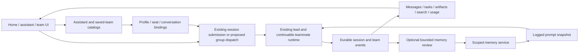

# Persistent assistants and team collaboration

English | [中文](2026-10-12-persistent-assistants-and-teams-design.zh.md)

Status: proposed design for owner review, not an implemented product contract. Scope: general assistants and teams, with institution templates. Evidence date: 2026-10-12. Communication uses English; proposed desktop labels use Chinese.

## Summary

Little Green Whale already provides durable sessions, continuable teammates, durable member messaging, a shared task board, standing institution squads, and a collaboration dock. The proposed product adds reusable assistant identities and user-defined teams above that runtime. A user can talk privately with an assistant, open a team, manage explicit memory, and inspect assignments and results without understanding sessions or subagents. A later phase adds a shared group conversation and optional automatic memory review.

The main gap is product organization plus several Host services. Session persistence does not by itself provide assistant memory; member messaging does not by itself provide group conversation semantics; a roster entry does not by itself provide an assistant that can participate in multiple teams.

## Contents

- [Evidence and limits](#evidence-and-limits)
- [Composer predictions](#composer-predictions)
- [Capability comparison](#capability-comparison)
- [Options and recommendation](#options-and-recommendation)
- [Frontend experience](#frontend-experience)
- [Frontend and backend work](#frontend-and-backend-work)
- [Identity and data ownership](#identity-and-data-ownership)
- [Host services and message flow](#host-services-and-message-flow)
- [Delivery stages and acceptance](#delivery-stages-and-acceptance)

<a id="evidence-and-limits"></a>

## Evidence and limits

This review uses the local `master` checkout at `/Users/apple/deepseek-harness`, including the Host and Client sources linked below. The earlier comparison used the Octopus upgrade checkout and DS Bot sources and screenshots. DS Bot's package version 0.1.2 and documented Harness test target 0.2.1-alpha.1 were rechecked against its primary sources on the evidence date; neither establishes compatibility with our Tauri carrier or fork composition. The proposed services below remain unimplemented.

The review reran the six-file suite below: 109 tests passed. DS Bot's `node --test ds-bot/test/steward.test.js` passed 9 pure helper cases in its separate reference checkout; those tests do not exercise live model decisions or end-to-end session rotation. These checks cover existing behavior, not the proposed services, a complete DS Bot audit, or installed-DMG behavior. This local rerun emitted a Vite TypeScript-path configuration warning and no FileHandle garbage-collection warning; it does not establish leak-free cleanup.

```sh
pnpm exec vitest run packages/experimental/agent-team/tests/institution.spec.ts packages/experimental/agent-team/tests/team.spec.ts packages/experimental/agent-team/tests/persistence.spec.ts packages/experimental/agent-team/tests/interactions.spec.ts packages/experimental/client-ui-agent-team/tests/institution-squads.client.spec.tsx packages/experimental/client-ui-agent-team/tests/team-action.client.spec.tsx
```

Some README limitations are behind the source: our team dock actually refreshes every 1.5 seconds while open and renders topology and summary tabs. Source takes precedence for this proposal. The proposal does not alter those README files.

Primary local evidence:

- [Team service and remotes](../../packages/experimental/agent-team/src/index.ts), [roster](../../packages/experimental/agent-team/src/roster.ts), and [mailbox](../../packages/experimental/agent-team/src/mailbox.ts).
- [Fixed institution catalog](../../packages/experimental/agent-team/src/institution.ts) and [public team types](../../packages/experimental/agent-team/src/types.ts).
- [Institution-card interaction](../../packages/experimental/client-ui-agent-team/src/client/InstitutionSquads.tsx), [collaboration dock](../../packages/experimental/client-ui-agent-team/src/client/TeamAction.tsx), and [body-free interaction projection](../../packages/experimental/agent-team/src/interactions.ts).
- [Composer actions](../../packages/client/ui-conversation/src/client/contract/input.ts), [input facade](../../packages/client/ui-conversation/src/client/input/facade.ts), and [trigger-menu behavior](../../packages/client/ui-input-trigger/README.md).
- [Session model selection](../../packages/api/session-controller/src/commands.ts), [session-query search](../../packages/session-query/session-query-sqlite/README.md), and [token measurement](../../packages/llm/token-meter/README.md).
- [Desktop plugin pins](../../scripts/desktop-profile-plugins.json) and [runtime dependency collection](../../scripts/collect-runtime-deps.mjs).
- [Domain-storage limitations](../../packages/storage/storage-domain/README.md#known-limitations-and-deferred-work), [continuation activation and interruption](../../packages/subagent/subagent/src/continuation-activation.ts), and [sidebar registration slots](../../packages/client/ui-sidebar/src/client/contract/slots.ts).

Primary DS Bot evidence: [package version](https://github.com/Fei2411/DeepSeek-Bot/blob/32ad48632c8ef9977d8c090396b6d6607bed859e/ds-bot/package.json), [documented compatibility](https://github.com/Fei2411/DeepSeek-Bot/blob/32ad48632c8ef9977d8c090396b6d6607bed859e/ds-bot/README.md), [Host entry](https://github.com/Fei2411/DeepSeek-Bot/blob/32ad48632c8ef9977d8c090396b6d6607bed859e/ds-bot/index.js), [roster](https://github.com/Fei2411/DeepSeek-Bot/blob/32ad48632c8ef9977d8c090396b6d6607bed859e/ds-bot/src/host/roster.js), [delivery](https://github.com/Fei2411/DeepSeek-Bot/blob/32ad48632c8ef9977d8c090396b6d6607bed859e/ds-bot/src/host/delivery.js), [groups](https://github.com/Fei2411/DeepSeek-Bot/blob/32ad48632c8ef9977d8c090396b6d6607bed859e/ds-bot/src/host/groups.js), [models](https://github.com/Fei2411/DeepSeek-Bot/blob/32ad48632c8ef9977d8c090396b6d6607bed859e/ds-bot/src/host/models.js), [memory](https://github.com/Fei2411/DeepSeek-Bot/blob/32ad48632c8ef9977d8c090396b6d6607bed859e/ds-bot/src/host/memory.js), [parts](https://github.com/Fei2411/DeepSeek-Bot/blob/32ad48632c8ef9977d8c090396b6d6607bed859e/ds-bot/src/host/parts.js), [usage](https://github.com/Fei2411/DeepSeek-Bot/blob/32ad48632c8ef9977d8c090396b6d6607bed859e/ds-bot/src/host/usage.js), and [Client registration](https://github.com/Fei2411/DeepSeek-Bot/blob/32ad48632c8ef9977d8c090396b6d6607bed859e/ds-bot/src/client/index.js). These external source links pin the inspected revision; newer releases require a fresh comparison.

<a id="composer-predictions"></a>

## Composer predictions

OpenAI describes Composer predictions as a complete suggested next message based on the current thread after a response. Tab accepts it into editable text; acceptance does not submit it. The system may skip a prediction, and it does not independently retrieve memories or connected-app data. These are documented behaviors; OpenAI does not disclose the internal inference API, model arrangement, or exact instruction in the [feature documentation](https://help.openai.com/en/articles/20001601-composer-predictions-in-codex).

Composer predictions are an app capability distinct from an assistant explicitly returning a follow-up button. This comparison establishes an interaction pattern, not evidence about which mechanism produced a suggestion in any particular chat.

For our product, distinguish three implementations:

| Experience | Generation | Required work |
|---|---|---|
| Template chips such as「补充资料」「请审核这份初稿」 | Localized, authored text | Client only; use existing composer actions after an explicit click |
| Structured next actions attached to a result | Existing tool/result metadata when available; a new schema when absent | Client rendering plus a Host/result addition for genuinely new actions |
| Context-aware suggested next message | A separate, bounded, tool-free model call | New Host service plus Client prediction state and keyboard handling |

Proposed automatic flow: committed turn ends → eligible foreground conversation and empty editable draft → Host reads a bounded permitted context snapshot → tool-free call returns one suggestion or none → Client displays ghost text → Tab or a visible「采用建议」button inserts editable text → user sends normally. The suggestion is not a user message before acceptance and submission.

Each request carries conversation identity, session generation, last committed sequence, draft revision, and a request id. Responses apply only if all still match, the draft remains empty, and submission is unlocked. Typing, navigation, disposal, or a newer turn cancels or invalidates the request. Use revision-guarded `insertText`, not unconditional `setDraft`, for delayed acceptance; preserve attachments and reference chips. IME composition, an open `/` or `@` menu, and existing keyboard focus rules take precedence over prediction acceptance. Never overwrite a draft or call `submit()` on prediction acceptance.

Start with local template chips. Offer automatic predictions as an optional setting after usage attribution exists. Run at most one bounded prediction per eligible completed turn; configurable token, time, and context limits belong to the Host Config. Failure quietly removes the suggestion while normal typing continues. Auxiliary inference gets its own logged request and usage attribution, without adding prediction-generation text to the user's main transcript. Unlike Codex's documented beta billing, our provider calls consume the user's configured model quota.

<a id="capability-comparison"></a>

## Capability comparison

“Existing” below means the inspected source provides the mechanism, with focused execution where listed above. It does not mean every mechanism has been tested in the installed app.

| Capability | DS Bot implementation | Octopus evidence and actual gap |
|---|---|---|
| Basic execution | DSH sessions, models, and tools | Same underlying Harness capabilities; no new agent engine needed |
| Assistant identity | Bot record with name, role, instructions, avatar, model | Our durable roster has named team members; it is not an independent user-managed assistant directory |
| Persistent conversations | Bot maps its visible chat to session parts | Our durable root/child sessions resume; assistant-to-conversation catalog is needed |
| Standing teams | User-created bots and groups | Three fixed institution squads reuse a lead and provision seats once; arbitrary team CRUD is absent from that catalog |
| Member messaging | Bot relay with exchange identity and follow-up/steer delivery | Our durable mailbox queues, flushes, acknowledges, and deduplicates team messages; membership is restricted to one lead's team |
| Shared group conversation | Ordered room rounds, admin-first mode, mentions, passing, separate per-member room sessions | No equivalent shared room transcript or round scheduler in the inspected Team service; mailbox edges are insufficient |
| Human direct chat | Private bot conversations | Existing addressed-child navigation supports human continuation; opening it does not create a private conversation isolated from that child's team context |
| Task board | Inspected room UI centers on conversation | Our service already supplies ownership, dependencies, revisions, and overlap warnings; preserve it |
| Collaboration visualization | Bot activity and exchanges | Our dock has topology, member state, task edges, message edges, and summary preview; polish and reposition it |
| Message timeline | Bot exchanges and shared-room posts | TeamView exposes edges without bodies; a paginated authorized message/result projection is needed |
| Model selection | Bot configuration applies to private and group sessions | Our institution update changes catalog settings, not already-spawned members; effective-route mutation needs explicit semantics |
| Default-model isolation | DS Bot saves/restores the Harness default around session selection | Our `selectModel` also asynchronously saves the global default; assistant-specific selection must not silently change it |
| Long chat | Steward chooses checkpoint or session-part rotation; old parts indexed | Native compaction and session search exist; hidden multi-part continuity is a separate addition and not required for first release |
| Memory | Bot scope, shared scope, tools, review after turns, editable panel, change journal | No equivalent assistant-memory service found in the inspected Team packages; session history and knowledge libraries are different resources |
| Search | FTS across private and group parts | Session-query SQLite search exists; assistant/team scope authorization and result attribution need adapters |
| Usage | Session calls plus auxiliary calls attributed by bot, room, model, time | Token-meter has session projections; cross-session attribution, auxiliary accounting, and aggregate pages need Host work |
| Scheduling | Bot-facing schedule management | Schedule services exist; assistant/team target identity, permissions, and visible execution history need integration |
| Browser | Per-bot desktop panel; DOM reading and isolated partitions | Browser-use mechanisms exist; Tauri embedding, per-assistant login isolation, and this UX are not established by those mechanisms |
| Secrets | Secret-request cards, per-bot grants, shell env injection, masking | Credentials infrastructure exists; arbitrary assistant-specific secret grants/cards/masking are not established by Team support |
| Voice | Dedicated dictation and voice UI modules | Our media/transcription capability is separate; it does not establish realtime voice parity; defer this comparison to its owner |
| Distribution | Web plugin and upstream desktop integration | Our Tauri shell and pinned overlay closure require their own build and packaged-runtime validation |

<a id="options-and-recommendation"></a>

## Options and recommendation

| Approach | Benefit | Limitation |
|---|---|---|
| Reorganize current team UI only | Smallest change; exposes real existing work | Cannot honestly provide generic assistants, arbitrary teams, private/shared isolation, or managed memory |
| Add product services above our runtime — recommended | Retains durable coordination and task board; creates general assistant/team UX | Requires identity, catalog, route updates, transcript projection, and later group/memory services |
| Adopt DS Bot as an optional integration | Reuses its complete bot/group experience if compatible | Adds another coordination/state system; its slot replacements and upstream desktop assumptions require explicit fork/Tauri validation |

Use DS Bot's interaction ideas: assistants and groups are immediately visible; clicking a name opens its conversation; details live in a right drawer; creation works through a form or a conversation. Preserve our task board and topology rather than reproducing its product wholesale. Do not make installing this community plugin part of default boot as a shortcut.

<a id="frontend-experience"></a>

## Frontend experience

### Home and navigation

The first screen remains the home page with the Little Green Whale brand and shallow beach atmosphere. The normal default assistant remains `standard`. A default「我的助手」entry is a product identity using that preset, not a new replacement preset. Existing data, knowledge, media, and professional-capability entry points remain accessible.

The home shows「常驻助手」and「我的团队」cards above recent conversations. The sidebar groups「首页」「助手」「团队」「最近会话」; it does not convert every ordinary conversation into a bot. Assistant cards show name, one-line responsibility, profile default model, and aggregate「待命 / 工作中 / 等待你」state with links to the relevant conversations. Each conversation or seat shows its own effective model; a profile used in several places need not have one effective route. “Persistent” does not mean a continuously running background process.

Add assistant/team destinations through `sidebar.panellist` and matching main-panel registrations, and retain the existing workspace browser. `sidebar.workspaces` is one whole-browser slot, not an insertion point for arbitrary sections. Home cards use the existing home extension points; implementing the navigation must not replace workspace, file, or search behavior.

Users can start ordinary conversation immediately. Assistant/team creation uses an app-managed default workspace unless the user chooses another folder; the home does not require a Node or workspace-selection wizard. Workspace initialization and failure recovery are Host responsibilities, not hidden Client guesses.

### Assistant conversation

The header shows avatar, name, responsibility, and effective model. A visible「详情」button opens a drawer with「职责」「模型」「记忆」「能力范围」「定时任务」. Each section reflects a real capability; memory and scheduling controls appear only after their services exist. The conversation retains existing attachment, tool, approval, and transcript UI.

The empty composer offers up to three short role-specific examples. Clicking one fills an editable draft, preserving existing content through explicit insert/replace choices. After a reply, authored result actions can appear above the composer. Automatic prediction later appears inside the input as ghost text with「Tab 采用」and a pointer-accessible alternative.

「开始新话题」opens another private conversation for the same assistant profile. Role and selected memory persist; prior conversation text is not implicitly copied. A user can deliberately reference an earlier conversation. This is simpler to validate than invisible session rotation and clearly separates profile identity from context length.

### Assistant creation and editing

「新建助手」asks for name, responsibility, model, and optional instructions. Avatar/color is secondary. Advanced settings contain workspace, allowed skills/tools, and memory policy. The model picker uses the served catalog and shows unavailable selections explicitly.

Creation saves the assistant profile before provisioning a conversation. A provisional card shows progress; a failed creation has「重试」using the same operation identity, avoiding duplicate profiles or sessions. Editing a role or model displays「下次请求生效」when current work is active, with requested and effective settings distinguished until acknowledged.

Users may also ask「帮我建一个资料整理助手」. A model-facing creation tool uses the same Host operation and returns the created card; UI and model do not own competing creation paths. Administrative authority follows existing policy and explicit task intent, not an automatically privileged “Chief” persona.

### Team creation and entry

「新建团队」offers a blank team plus 文书组 / 案例组 / 传播部 templates. A template is copied into an editable definition; it is not a hard-coded permanent team type. The user chooses a coordinator, adds assistants, edits duties, picks seat models, and chooses the shared workspace. V1 provides a visible effective model per seat and a team coordinator that receives ordinary messages first.

Existing institution teams initially appear as existing teams with their current lead and member history. Conversion to editable definitions occurs through a separately verified adoption operation; the UI must not silently create another team or respawn seats. Ad-hoc session teams retain the label「临时团队」; saved teams use「常驻团队」.

### Team working view

The primary view uses three regions: navigation on the left, the coordinator conversation or shared discussion in the center, and an optional adjustable collaboration dock on the right. The center header offers「讨论」「任务」「成果」. The first stage's「讨论」is clearly labeled「协调员会话」; it must not present scattered child output as an already-shared group chat.

In the group phase, public member messages show their author, role, time, and reply/dispatch context. The composer supports semantic「@成员」chips and「+ 引用资料 / 引用会话」. Ordinary messages go to the coordinator; a selected member receives a direct public turn. Merely mentioning a name in a document or inserting a conversation reference does not dispatch that assistant.

The dock keeps topology prominent and tasks/operations below it. Clicking an edge opens a paginated message trace when supported. Clicking a member offers「查看团队工作记录」and「打开私人会话」as separate actions, because their contexts differ. Closed docks stop polling. A team finishing its work reveals the existing summary-diagram action and produced artifacts with links to their source sessions.

### Layout sketch

| Left navigation, about 220 px | Main conversation, flexible width | Optional dock, about 320–480 px |
|---|---|---|
| Little Green Whale / 首页 | 团队名称 · 协调员 · 当前状态 | 协作动态 / 团队详情 |
| 助手: 我的助手、资料员、写作员 | 讨论 / 任务 / 成果 | Member topology with named roles |
| 团队: 文书组、自定义项目组 | Authored messages, dispatch cards, tool output | Selected member, effective model, current task |
| 最近会话 / 搜索 | Composer: recipients, references, attachments | Tasks and operations below topology |

Suggested sizing is a design starting point, not a fixed window requirement. Below the three-column fit, the dock becomes a drawer and the sidebar collapses. Use current theme tokens, typed Chinese/English dictionaries, keyboard navigation, and reduced-motion support. Status and author remain legible without color or animation.

<a id="frontend-and-backend-work"></a>

## Frontend and backend work

| Change | Classification | Exact dependency |
|---|---|---|
| Polish existing institution cards and expose existing team dock | Client only | Current remotes, slots, locale dictionaries |
| Reorganize task board and member navigation | Client only | Current TeamView and task remotes; team-child navigation remains labeled accurately |
| Static prompt-example chips and editable acceptance | Client only | Existing InputActions; draft preservation and keyboard checks |
| Show known member model ids and topology | Client only, with qualified labels | Existing values can be configured, observed, or unknown; institution projection can mix a configured provider with an observed model, so it cannot establish an effective route |
| General assistant directory with durable name/avatar/role/pinning | Client + new Host service | Assistant catalog; browser-only metadata would not serve model tools, restart recovery, or multiple clients |
| User-defined teams and editable membership | Client + new Host service | Generic definitions, session/seat bindings, provisioning and member-retirement policy |
| One assistant in multiple teams and a private chat | Client + new Host service | Reusable profile identity plus separate private and per-team instances |
| Change an existing assistant/seat model | Client + Host integration | Requested/effective route, next-request installation, cold-resume persistence, global-default isolation |
| Public `@` dispatch and shared group transcript | Client + new Host service | Semantic recipients, room journal, round scheduler, correlation and visibility rules |
| Show full member-message timeline | Client + Host projection | Authorized paginated bodies and durable delivery state, not just graph edges |
| Managed memory and background review | Client + new Host service | Scope, journal, source references, injection, review deduplication, and usage |
| Search assistant/team history | Client + Host adapter | Existing session-query search with permitted session bindings and stable attribution |
| Profile-specific skills, tools, and data/knowledge access | Client + Host integration | Served capability catalog, actual tool policy, and explicit per-conversation source bindings |
| Unread state across windows on one Host | Client + Host integration | Durable read cursor for logical conversation; cross-device synchronization is outside this design |
| Assistant/team usage dashboard | Client + Host aggregation | Session attribution and auxiliary inference accounting |
| Contextual composer predictions | Client + new Host service | Bounded tool-free inference and revision-safe acceptance |
| Assistant-bound scheduled work | Client + Host integration | Existing schedule runtime plus target resolution and policy |
| Per-assistant embedded browser / secrets | Separate Client + Host/carrier work | No parity claim until Tauri and credentials integration is verified |

Frontend-only means the existing server can return every authoritative fact and perform every required action. A pretty control for an action the Host cannot perform is not frontend-only work.

<a id="identity-and-data-ownership"></a>

## Identity and data ownership

Introduce proposed branded identifiers for assistant profiles, saved team definitions, memberships, and logical conversations. Keep runtime SessionId and TeamId intact. Do not change the existing invariant that a runtime team belongs to its lead Session or let a foreign root masquerade as its child.

| Proposed entity | Ownership and meaning |
|---|---|
| AssistantProfile | Stable identity, display metadata, responsibility/instructions revision, default model route, capability policy, archive state |
| TeamDefinition | Editable name, coordinator profile, membership definitions, shared workspace, template origin, revision |
| TeamSeat | One profile's participation in one team, its local duty/model override, and ordered runtime-instance bindings; replacements preserve prior child history; the coordinator binds to the lead |
| ConversationBinding | Private profile conversation or a team's discussion, with permitted session ids and lifecycle state |
| MemoryEntry | Scope, text, source session/event, revision, author, creation/update time, and removal history |
| GroupRound | Accepted human message, chosen recipients, ordered speaker slots, durable result references, and terminal status |
| ProvisioningOperation | Stable request id, normalized input fingerprint, allocated identities, completed writes, and recoverable failure state |

One assistant profile can have multiple private root conversations and a distinct continuable child for each team's lead. New private topics, team leads, and team seats start with fresh context; never fork a profile's private history to create a team participant. Reuse profile metadata and explicitly granted memory only. Team-generated observations remain team-scoped by default; promoting them into private assistant memory requires an owner-authorized operation. A team sees its own materials and granted profile memory, not an assistant's unrelated private chats or other teams' records.

Team workspace and task dependencies come from the team's owning definition. Once provisioned, V1 fixes the coordinator profile/lead binding and workspace; changing either creates a new team definition and fresh runtime through an explicit copy operation. Names, duties, and supported configuration revisions remain editable. Existing runtime teammates continue to share that team's workspace. Different cwd values per seat and runtime reparenting are outside V1.

Catalog metadata uses versioned parsing and revision-checked writes through the existing storage domain. Its single-record serialization supplies neither cross-table transactions nor schema migration. One Host owns catalog writes; all its windows call that Host. A second writer to the same catalog must be refused through process ownership enforcement; cross-device synchronization is deferred. Schema upgrades require an explicit migration and backup/recovery procedure before a newer version opens the catalog.

Provisioning commits an operation record before creating runtime sessions, then checkpoints each allocation and binding. Retrying the same operation id and input resumes it; reusing an id with different input fails. Runtime allocation must durably associate the operation with its session/roster result so recovery can find an already-created child after a crash. Do not invent caller-selected child ids if the provider cannot accept them. An ambiguous allocation remains visible for repair instead of spawning again. Publish「就绪」only after validating every required binding; incomplete teams display failed seats and retry actions.

Session logs remain authoritative for execution, messages, tool results, and anything sent to a model. Catalog records identify configuration revisions; logged request snapshots preserve the exact resolved inputs used. Team and room projections link to durable source events rather than inventing final answers in browser state. Search/usage indexes can be rebuilt; profile, binding, membership, operation, and memory records cannot be treated as disposable indexes.

Archiving a profile hides its directory entry and prevents new private submissions, topics, or memberships; existing team seats retain their identity and remain usable in their team. Archiving a team blocks admission of new tasks. Continuations, delegated assignments, and replies belonging to already-admitted work may finish in either case; history remains readable and cancellation is separate. Serialize archive/removal checks with every affected admission path. Unarchive restores entry points. V1 provides archive, not destructive profile/team deletion.

Seat removal requires no active work, pending input, or unfinished owned tasks; the UI directs the user to finish, cancel, or reassign them first. Removal then persists retirement and rejects future routing through both UI and existing team tools. The runtime currently has no retired member phase, so enforcement is Host work. Roster names remain permanently reserved. A failed spawn cannot be retried under that name: an explicit replacement keeps the logical seat id, records a new runtime instance/name, and preserves the failed instance's history. Display-name edits never rewrite routing identities.

Institution adoption claims the existing catalog binding under its expected revision, validates the lead and every child's parent/continuation descriptor, then commits the definition mapping once. A changed binding, an already adopted lead, or an unreadable child requires repair. Do not call institution provisioning on a new root as an adoption shortcut: it can replace the stored lead. Preserve the existing effective and configured routes as distinct observations until reconciled.

<a id="host-services-and-message-flow"></a>

## Host services and message flow

The following are proposed operations, not current APIs. Each new capability needs a Service Definition, Host provider, Client/model consumer, and executed registration through Cordis effects. Place fork additions in experimental overlay packages; leave official desktop shell, desktop-app, and companion product logic unchanged.

| Proposed owner | Operations and existing mechanisms reused |
|---|---|
| Assistant catalog and lifecycle | list/create/update/archive profiles; open/create private conversations; session-controller and system-prompt sections |
| Saved-team catalog | create/update/archive definitions; adopt existing institution bindings; ensure runtime lead/seats; existing agentTeams provisioning/mailbox/task board |
| Assistant/seat configuration | get requested/effective settings; install validated next-request route; persist cold-resume route and role revision |
| Team discussion | submit/dispatch/cancel round; list public messages and member traces; shared source journal and existing continuable delivery |
| Memory | list/save/replace/remove/recall; optional review; versioned snapshot injection and source references |
| Product projections | catalog/read cursors, search scoping, artifact attribution, usage summaries; existing session-query, projections, and token-meter |
| Composer suggestions | predict one next-message suggestion; existing llm runtime and optional auxiliary-call attribution |

Model configuration must distinguish the inference provider route from the continuable spawning provider. Validate against the served model catalog before accepting a change. Resolve precedence as conversation override → team-seat override → profile default; capture the application's default into the profile at creation if none was selected. Clearing an override returns to the next level. The conversation picker changes only that conversation; profile edits reach existing conversations/seats that still inherit that field. Each affected instance reports its own pending and effective revision; a successful profile save is not proof that every instance switched.

Apply one resolved model/role/capability revision at a safe request boundary, not halfway through streaming; serialize it with image admission and creation. Persist pending settings before acknowledging them and reapply them before the first cold-resumed request, including a crash before any request logged the new route. Report actual request-used settings separately. Prove no update changes the application's default model. The existing `selectModel` saves that default asynchronously, so reuse its underlying next-request mechanism through an explicit session-local operation rather than wrapping it with save/restore. An unavailable inherited route fails visibly; no silent model substitution.

An assistant role is a versioned request input: the profile supplies responsibility and instructions, and the seat adds a separately identified team duty. A profile-role edit reaches all bound instances on their next request; a duty edit affects only that seat. The update produces a future logged system-prompt snapshot without rewriting history. Show affected teams before saving a shared profile edit.

An assistant's responsibility text does not grant capabilities. Effective permissions intersect deployment policy, profile policy, and any narrower team/conversation grants; role or duty text cannot widen them. Enforce grants in tool discovery and execution, including direct team tools, search, and source-reference resolution. Derive model-call scope from the live Agent's binding, never from a caller-supplied profile/team id alone. UI remotes validate the owning user's access independently. Data/knowledge providers and filesystem tools must enforce the same allowed-source policy; separate histories alone are not filesystem isolation.

Changing a capability or source binding updates actual request/tool context and its logged representation. Revocation prevents subsequent access and cancels or drains already-started operations according to the owning provider's documented policy. If a provider cannot enforce the proposed restriction, mark that capability unavailable rather than claiming isolation through a checkbox or prompt.



### First-stage team dispatch

1. User opens a saved team. Host resolves its existing lead and seats without creating duplicates.
2. The ordinary prompt reaches the coordinator through the existing session submission path.
3. The coordinator uses current team tools to assign work and message teammates. The task board and mailbox remain authoritative.
4. Client renders the coordinator answer, roster state, topology, and task updates. Child histories remain separate accessible work records.
5. Completion presents produced artifacts and the existing summary action. “All members idle” alone is not proof that a particular user request was completed.

### Shared discussion phase

1. Host commits the accepted human group message and a round id before dispatch. Recipient chips carry assistant/seat ids; references carry reference ids, with no name-string inference.
2. A plain message schedules the coordinator first. Explicit recipients choose speakers; a configurable maximum bounds seats, repeated handoffs, rounds, and token use.
3. Each selected seat reads the permitted public transcript through a committed cursor. Speakers respond in order so a later member sees earlier public replies. Tool execution within a seat can still use existing delegated work; a room round does not require every member to answer.
4. The dispatcher persists `(roundId, slotId, attemptId)` to inbox receipt and source-event mappings before treating delivery as accepted. Existing mailbox sends allocate a fresh id each time; keyed admission needs a new Host/runtime operation. `running`/`idle` and a bare `followup()` return do not identify a result. A failed, cancelled, timed-out, silent, or interrupted/uncertain slot records its own state.
5. Group messages reference their source session/event and author. Deduplicate admission and public posting separately. Recovery can publish a committed but not-yet-posted reply; it must not automatically repeat a model/tool execution when side-effect completion is unknown. Display「执行结果待确认」with inspection and explicit retry instead of promising exactly-once external effects.

Serialize rounds per discussion and arbitrate each seat's execution with coordinator dispatch, team tools, and direct-child continuation. A slot owns an execution interval before admission. Its ownership token follows authorized delegation and replies so they can complete within that interval; only unrelated work queues until ownership releases. Reject unresolvable mixed ownership rather than deadlocking a coordinator awaiting its own delegated result. Cancellation removes only that slot's unstarted input and interrupts active work only when it belongs to the slot. Existing whole-agent interruption preserves the entire inbox and cannot supply this guarantee. Keyed cancellation and recovery of execution ownership are Stage C prerequisites, with a visible failure state when they cannot be established.

The first group release supports coordinator-first and explicit-recipient routing. “Everyone responds” is optional later. Full message bodies are paginated and fetched on demand; the graph continues using lightweight edges. Polling stops when its consuming surface closes; later subscriptions must have explicit disposal and generation handling.

### Memory and history

Start with explicit「记住这条」and an editable memory panel. Support own-profile and team scopes with source links, revision conflicts, deletion, and archive semantics. Model tools may write only the scope granted to their live conversation; team members cannot promote a team observation into private profile memory without an owner-authorized operation. Inject a bounded revisioned snapshot into the logged prompt; recall reads newer permitted entries. Do not represent a knowledge library as memory or promise that compaction preserves every fact.

Removal or grant revocation excludes an entry from subsequent memory injection, recall, and memory search. It does not erase historical prompt snapshots, already-seen tool output, summaries, or answers; independently authorized session-history search may still find them. The UI states this distinction and offers a fresh topic without the old conversation history. Content erasure from immutable session records is a separate retention/deletion design and is outside V1.

Add automatic review only after explicit memory works. Process each committed user-turn range once, serialize updates per scope, reject secrets and tool/web instructions, distinguish user corrections from agent guesses, and account for the model call. Failures do not block ordinary conversations. Versioned prompt inputs must remain reconstructable from the session log.

Keep native compaction in V1. Opening another topic under the same profile gives durable identity without hidden session rotation. If continuous multi-part chat becomes necessary, add a separate logged handoff protocol with pending-input transfer, source anchors, and overflow/cancellation recovery; do not disable native compaction without a tested replacement.

<a id="delivery-stages-and-acceptance"></a>

## Delivery stages and acceptance

### Stage A: truthful presentation of existing capabilities

Polish institution cards, promote the collaboration entry, improve roster/task navigation, and add authored prompt examples. This stage can ship largely as Client work, but it must keep the three fixed squads and coordinator conversation honestly labeled. It does not satisfy the full general-assistant/team objective by itself.

Acceptance: existing leads and seats are reused; topology and tasks reflect actual source data; closed docks stop refresh; example acceptance preserves a user's draft and never sends automatically; Chinese/English copy and keyboard/IME navigation work.

### Stage B: general persistent assistants and saved teams — minimum complete release

Deliver profile create/read/update/archive, private conversation bindings, generic team definitions, templates, recoverable provisioning, model/role updates, assistant creation tools, home/sidebar integration, and explicit memory management. Teams initially work through their coordinator and current durable task/mailbox runtime. Stage B is complete only when all three increments below pass; Stage A polish is optional parallel work.

| Increment | Deliverable | Required evidence before continuing |
|---|---|---|
| B1: one persistent assistant | Catalog, operation recovery, private topics, scoped configuration, home entry | Create → converse → change model/role → restart → reopen; requests use the saved settings and global default remains unchanged |
| B2: saved teams | Generic definitions, fresh seat instances, adoption, retirement, task/dock integration | Reuse a profile in two teams; reject cross-scope reads; inject crashes between allocation and binding; adopt without respawn; retired seats reject direct team-tool routing |
| B3: explicit memory and release | Scoped memory, authorized creation tools, final navigation, packaging | Remove memory from future injection/recall; distinguish retained history; prove UI/tool policy parity; verify the installed DMG on fresh and copied existing profiles |

Acceptance: create an arbitrary assistant/team; use an institution template; restart and reuse their identities/history; reuse one profile in two teams without leaking private or other-team context; distinguish team work records from private chats. Verify configuration inheritance, override removal, and a crash after saving a pending model change but before its first request. Model and UI creation share one operation and authorization policy. Existing institution bindings are adopted without respawn, failed instances recover without name reuse, and explicit memory has a logged injection record. No Stage B control depends on Stage C services.

### Stage C: public group collaboration and managed follow-up

Deliver group rounds, explicit `@` dispatch, public transcript/source attribution, paginated message traces, logical read cursors, scoped search, and usage aggregation. Then add optional automatic memory review and composer predictions, with bounded auxiliary accounting.

Acceptance: ordinary group prompts initially dispatch one coordinator; references never accidentally dispatch members; selected seats see only permitted public context. Crash tests cover acceptance, keyed inbox admission, committed reply, and public posting separately; known admissions/posts deduplicate and uncertain external effects require explicit recovery. Cancellation removes only owned input and never interrupts unrelated execution. Concurrent coordinator/tool/direct-child delivery obeys the same ownership rules. Profile/model changes during a round preserve per-request effective settings. Prediction results cannot apply after typing or navigation and never submit. Usage includes auxiliary calls and excludes inherited fork history from duplicate charging.

### Stage D: optional specialized integrations

Consider continuous multi-part chat, assistant-bound schedules, embedded browser profiles, richer secrets UI, and realtime voice separately. Existing providers reduce the work but do not establish complete product semantics or Tauri compatibility. None is a prerequisite for the general assistant/team release.

### Validation and distribution requirements

- Use focused Host tests with real persistence for every provisioning checkpoint, conflicting operation payload, second-writer rejection, adoption conflict, failed-instance replacement, route inheritance, cold resume, and retirement. Test forbidden scope access through remotes, model tools, search, references, and filesystem/data providers, not only through the UI.
- For Stage C, test keyed admission/posting under crash recovery and concurrent mailbox/direct-child work. Verify pending and active cancellation separately; an ambiguous external effect must not trigger automatic re-execution. Stage C remains unavailable until those prerequisites pass.
- Add Client cases for draft revisions, references, IME, menu-vs-Tab precedence, requested/effective model display, empty/loading/error states, keyboard focus, and responsive dock behavior.
- Add keyless recorded-session cases for model-visible creation tools, role/memory inputs, group dispatch, and output attribution. Update TypeScript and Python SDK outputs whenever the session event map or lifecycle changes.
- For persistence additions, acknowledge declared type changes, preserve committed generations, implement backup-or-stop migration where required, and register any fork events in every applicable released inventory. Update intake registry coverage for actual changed fork paths; no runtime-only bypass.
- Put new desktop bundles in the profile pins and all required Host workspace dependencies in the collected runtime closure. Verify source and built faces separately; a source-only UI is not delivery.
- The implementation release must build, package, and self-verify the installable DMG, including cold boot, existing-profile adoption, request/model behavior, and Tauri interaction. No new heavy dependency or media runtime is assumed by this design.

Before implementation, record the chosen source checkout and its validation baseline, assign each increment to its owning packages, and capture the catalog/event schema and migration decisions in the implementation plan. Resolve missing session-local configuration and runtime retirement operations in B1/B2; do not hide those dependencies in Client work. Follow the current intake registry and released-format owners rather than assuming that an older upgrade checkpoint still describes this checkout.

Design-document validation and product-release validation are separate. This draft adds no product code, session data migration, plugin installation, or application configuration change.
