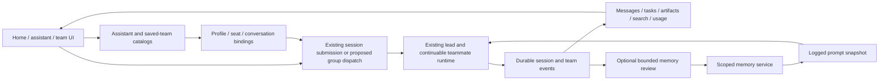

# 常驻助手与团队协作

[English](2026-10-12-persistent-assistants-and-teams-design.md) | 中文

状态：供项目负责人评审的设计草案，并非已经实现的产品约定。范围：通用助手和团队，附带机构模板。证据日期：2026-10-12。会话沟通使用英文；桌面产品的拟议文案使用中文。

## 概述

小绿鲸已经具备持久化会话、可继续运行的队友、持久化成员消息、共享任务板、常驻机构小组和协作面板。本方案在现有运行时之上增加可复用的助手身份和用户自定义团队。用户可以与助手私聊、进入团队、明确管理记忆、查看分工和成果，无需理解会话或子智能体。后续阶段再补共享群聊和可选的自动记忆复核。

主要缺口是产品组织方式以及若干 Host 服务。会话持久化本身不等于助手记忆；成员互发消息本身不等于群聊语义；名册中的一个成员本身不等于可加入多个团队的助手。

## 目录

- [证据与限制](#evidence-and-limits)
- [输入框预测](#composer-predictions)
- [能力对照](#capability-comparison)
- [可选路径与建议](#options-and-recommendation)
- [前端体验](#frontend-experience)
- [前后端工作划分](#frontend-and-backend-work)
- [身份与数据归属](#identity-and-data-ownership)
- [Host 服务与消息流程](#host-services-and-message-flow)
- [交付阶段与验收](#delivery-stages-and-acceptance)

<a id="evidence-and-limits"></a>

## 证据与限制

本次评审使用本地 `master` 检出版本（位于 `/Users/apple/deepseek-harness`），包括下方链接的 Host 和 Client 源码。之前的对比使用 Octopus 升级工作区，以及 DS Bot 源码和截图。在证据日期，已根据 DS Bot 的一手资料重新核对其包版本 0.1.2 及文档声明的 Harness 测试目标 0.2.1-alpha.1；两者都不能证明它兼容我们的 Tauri 外壳或分支插件组合。下文拟议服务仍未实现。

本次评审重新运行了下方六个文件的测试集，109 项测试通过。DS Bot 的 `node --test ds-bot/test/steward.test.js` 在单独的参考检出目录中通过了 9 项纯辅助函数测试；这些测试不执行真实模型决策或端到端会话轮换。这些检查覆盖已有行为，不覆盖拟议服务、DS Bot 完整审计或已安装 DMG 的行为。本地重跑输出了 Vite TypeScript 路径配置警告，未输出 FileHandle 垃圾回收警告；这不能证明清理过程不存在句柄泄漏。

```sh
pnpm exec vitest run packages/experimental/agent-team/tests/institution.spec.ts packages/experimental/agent-team/tests/team.spec.ts packages/experimental/agent-team/tests/persistence.spec.ts packages/experimental/agent-team/tests/interactions.spec.ts packages/experimental/client-ui-agent-team/tests/institution-squads.client.spec.tsx packages/experimental/client-ui-agent-team/tests/team-action.client.spec.tsx
```

部分 README 的限制说明落后于源码：我们的团队面板在打开时实际每 1.5 秒刷新，并渲染拓扑和总结标签页。本方案以源码为准，不修改这些 README。

本地主要证据：

- [团队服务与远程接口](../../packages/experimental/agent-team/src/index.ts)、[名册](../../packages/experimental/agent-team/src/roster.ts)和[邮箱](../../packages/experimental/agent-team/src/mailbox.ts)。
- [固定机构目录](../../packages/experimental/agent-team/src/institution.ts)和[公开团队类型](../../packages/experimental/agent-team/src/types.ts)。
- [机构卡片交互](../../packages/experimental/client-ui-agent-team/src/client/InstitutionSquads.tsx)、[协作面板](../../packages/experimental/client-ui-agent-team/src/client/TeamAction.tsx)和[不含消息正文的交互投影](../../packages/experimental/agent-team/src/interactions.ts)。
- [输入框动作](../../packages/client/ui-conversation/src/client/contract/input.ts)、[输入接口实现](../../packages/client/ui-conversation/src/client/input/facade.ts)和[触发菜单行为](../../packages/client/ui-input-trigger/README.zh.md)。
- [会话模型选择](../../packages/api/session-controller/src/commands.ts)、[会话搜索](../../packages/session-query/session-query-sqlite/README.zh.md)和[Token 计量](../../packages/llm/token-meter/README.zh.md)。
- [桌面插件固定清单](../../scripts/desktop-profile-plugins.json)和[运行时依赖收集](../../scripts/collect-runtime-deps.mjs)。
- [存储域限制](../../packages/storage/storage-domain/README.zh.md#known-limitations-and-deferred-work)、[可继续会话的激活与中断](../../packages/subagent/subagent/src/continuation-activation.ts)和[侧栏注册 slot](../../packages/client/ui-sidebar/src/client/contract/slots.ts)。

DS Bot 的主要证据：[包版本](https://github.com/Fei2411/DeepSeek-Bot/blob/32ad48632c8ef9977d8c090396b6d6607bed859e/ds-bot/package.json)、[文档声明的兼容性](https://github.com/Fei2411/DeepSeek-Bot/blob/32ad48632c8ef9977d8c090396b6d6607bed859e/ds-bot/README.md)、[Host 入口](https://github.com/Fei2411/DeepSeek-Bot/blob/32ad48632c8ef9977d8c090396b6d6607bed859e/ds-bot/index.js)、[名册](https://github.com/Fei2411/DeepSeek-Bot/blob/32ad48632c8ef9977d8c090396b6d6607bed859e/ds-bot/src/host/roster.js)、[投递](https://github.com/Fei2411/DeepSeek-Bot/blob/32ad48632c8ef9977d8c090396b6d6607bed859e/ds-bot/src/host/delivery.js)、[群聊](https://github.com/Fei2411/DeepSeek-Bot/blob/32ad48632c8ef9977d8c090396b6d6607bed859e/ds-bot/src/host/groups.js)、[模型](https://github.com/Fei2411/DeepSeek-Bot/blob/32ad48632c8ef9977d8c090396b6d6607bed859e/ds-bot/src/host/models.js)、[记忆](https://github.com/Fei2411/DeepSeek-Bot/blob/32ad48632c8ef9977d8c090396b6d6607bed859e/ds-bot/src/host/memory.js)、[分段](https://github.com/Fei2411/DeepSeek-Bot/blob/32ad48632c8ef9977d8c090396b6d6607bed859e/ds-bot/src/host/parts.js)、[用量](https://github.com/Fei2411/DeepSeek-Bot/blob/32ad48632c8ef9977d8c090396b6d6607bed859e/ds-bot/src/host/usage.js)和[Client 注册](https://github.com/Fei2411/DeepSeek-Bot/blob/32ad48632c8ef9977d8c090396b6d6607bed859e/ds-bot/src/client/index.js)。这些外部源码链接固定到本次检查的修订版本；新版本需要重新比较。

<a id="composer-predictions"></a>

## 输入框预测

OpenAI 将 Composer predictions 描述为：回答结束后，根据当前会话预测一条完整的下一条消息。Tab 将建议接受为可编辑文字，接受不等于发送。系统也可以不生成建议，而且不会自行检索记忆或连接应用的数据。这些是已公开的行为；[功能文档](https://help.openai.com/en/articles/20001601-composer-predictions-in-codex)没有披露内部推理 API、模型安排或确切提示词。

Composer predictions 是应用能力，与助手主动返回后续操作按钮不同。本次对比说明一种交互方式，不能据此判断某次具体会话中的建议由哪种机制生成。

在我们的产品中，应区分三种实现：

| 体验 | 生成方式 | 所需工作 |
|---|---|---|
| 「补充资料」「请审核这份初稿」等模板按钮 | 预先编写的本地化文字 | 只改 Client；用户点击后调用现有输入框动作 |
| 结果附带的结构化下一步操作 | 有现成工具结果元数据时复用；没有时增加字段定义 | Client 渲染；新操作需要 Host 或结果字段扩展 |
| 根据上下文建议下一条消息 | 独立、受限、禁用工具调用的模型请求 | 新增 Host 服务，以及 Client 的预测状态和键盘处理 |

拟议自动流程：一轮对话提交完成 → 前台会话满足条件且可编辑草稿为空 → Host 读取经过权限限制的有限上下文快照 → 禁用工具的模型调用返回一条建议或无建议 → Client 显示浅色提示 → Tab 或可见的「采用建议」按钮插入可编辑文字 → 用户正常发送。建议在接受并提交前不属于用户消息。

每个请求携带会话身份、会话代次、最后已提交序号、草稿修订号和请求 ID。只有这些值仍然匹配、草稿仍为空且没有锁定提交时，响应才能生效。输入、导航、销毁或新一轮对话会取消请求或使它失效。延迟接受使用带修订号校验的 `insertText`，不能无条件 `setDraft`；保留附件和引用标签。输入法组合输入、已打开的 `/` 或 `@` 菜单，以及已有键盘焦点规则，优先于预测接受。不能覆盖草稿，也不能在接受建议时调用 `submit()`。

先提供本地模板按钮。建立用量归属之后，再将自动预测作为可选设置。每个满足条件的完成轮次最多执行一次受限预测；Token、时间和上下文限制通过 Host Config 配置。失败时安静移除建议，正常输入继续。辅助推理拥有独立的请求日志和用量归属，不能把生成建议时的文字加进用户主对话记录。与 Codex 文档中的测试期计费方式不同，我们的模型调用会消耗用户配置的模型额度。

<a id="capability-comparison"></a>

## 能力对照

下表中的「已有」表示检查的源码提供了相应机制，并在前述范围内做了定向执行；不代表每一种机制都已经在安装版应用中测试。

| 能力 | DS Bot 实现 | Octopus 证据与实际缺口 |
|---|---|---|
| 基础执行 | DSH 会话、模型和工具 | 使用同一 Harness 基础能力，无需新建智能体引擎 |
| 助手身份 | Bot 记录保存名称、职责、指令、头像、模型 | 我们的持久化名册保存团队成员，但不是独立、用户可管理的助手目录 |
| 持续会话 | Bot 将可见聊天映射到会话分段 | 我们可恢复持久化的根会话和子会话；需要助手与会话之间的目录 |
| 常驻团队 | 用户创建 Bot 和群组 | 三个固定机构小组可复用负责人并一次创建席位；目录没有任意团队的增删改查 |
| 成员消息 | Bot 转发带交换标识，采用 follow-up 或 steer 投递 | 我们的持久化邮箱支持排队、刷盘、确认和去重；成员属于同一负责人的团队 |
| 共享群聊 | 有序群聊轮次、管理员优先模式、提及、跳过发言、每成员独立群会话 | 检查的 Team 服务没有等价的共享群聊记录或轮次调度器；邮箱连线不能替代它们 |
| 用户直接聊天 | Bot 私人会话 | 现有子会话导航支持用户继续对话；打开它不等于创建与团队上下文隔离的私人会话 |
| 任务板 | 检查的群聊界面以对话为中心 | 我们已有归属、依赖、修订号和重叠警告，应保留 |
| 协作可视化 | Bot 活动和消息交换 | 我们的面板已有拓扑、成员状态、任务连线、消息连线和总结预览；需要完善并调整入口 |
| 消息时间线 | Bot 消息交换和公开群消息 | TeamView 只输出不含正文的连线；需要分页、经过权限校验的消息与结果投影 |
| 模型选择 | Bot 配置应用到私聊和群会话 | 我们的机构更新只改目录设置，不改已创建成员；实际模型更新需要明确语义 |
| 默认模型隔离 | DS Bot 在会话选模前后保存并恢复 Harness 默认设置 | 我们的 `selectModel` 也会异步保存全局默认值；助手单独选模不能暗中改变它 |
| 长对话 | 管家选择检查点或切换会话分段，旧分段进入索引 | 原生压缩和会话搜索已存在；隐藏分段连续对话需要单独补充，首发并不依赖它 |
| 记忆 | Bot 范围、共享范围、工具、逐轮复核、可编辑面板和变更日志 | 检查的 Team 包未发现等价的助手记忆服务；会话历史和知识库是不同资源 |
| 搜索 | 跨私人和群聊分段的全文索引 | 已有 session-query SQLite 搜索；需要助手与团队范围的授权和结果归属适配 |
| 用量 | 会话调用及辅助调用按 Bot、群、模型、时间归属 | Token-meter 已有会话投影；跨会话归属、辅助调用计量和汇总页面需要 Host 工作 |
| 定时任务 | 面向 Bot 的任务管理 | 已有定时服务；需要助手与团队目标身份、权限和可见执行历史的集成 |
| 浏览器 | 每 Bot 桌面面板、DOM 读取和独立分区 | 已有 browser-use 机制；不能据此认定已具备 Tauri 嵌入、助手登录隔离及该交互 |
| 密钥 | 密钥请求卡片、按 Bot 授权、Shell 环境注入和遮罩 | 已有凭据基础设施；Team 支持不能证明已有任意助手的专属密钥授权、卡片和遮罩 |
| 语音 | 独立听写和语音界面模块 | 我们的媒体及转写是独立能力，不能证明实时语音等价；该对比交给对应能力负责人 |
| 分发 | Web 插件和上游桌面集成 | 我们的 Tauri 外壳和固定插件依赖集合需要自己的构建及打包运行时验证 |

<a id="options-and-recommendation"></a>

## 可选路径与建议

| 路径 | 收益 | 限制 |
|---|---|---|
| 只重组现有团队界面 | 改动最小，让已有工作可见 | 不能如实提供通用助手、任意团队、私聊与群聊隔离或可管理记忆 |
| 在我们的运行时之上补产品服务，推荐 | 保留持久化协作和任务板，建立通用助手及团队体验 | 需要身份、目录、模型更新、记录投影，后续还需群聊和记忆服务 |
| 将 DS Bot 作为可选集成 | 兼容后可复用其完整 Bot 与群聊体验 | 多出一套协作与状态系统；其插槽替换和上游桌面假设需要明确验证分支及 Tauri 兼容性 |

参考 DS Bot 的交互：助手和群组立即可见，点击名称进入对话，详情放在右侧抽屉，创建既可通过表单也可通过会话。保留我们的任务板和拓扑，不整体复刻它的产品。不能把默认启动安装这个社区插件当作捷径。

<a id="frontend-experience"></a>

## 前端体验

### 首页与导航

首屏仍然是首页，保留小绿鲸品牌和浅海沙滩氛围。普通默认助手仍然是 `standard`。默认「我的助手」入口是使用该预设的产品身份，不是新的替代预设。已有问数据、问知识、媒体和专业能力入口保持可访问。

首页在最近会话上方展示「常驻助手」和「我的团队」卡片。侧栏组织为「首页」「助手」「团队」「最近会话」，不把每段普通会话都变成机器人。助手卡片展示名称、一行职责、身份默认模型，以及汇总的「待命 / 工作中 / 等待你」状态，并链接到相关会话。每段会话或每个席位显示自己的实际模型；同一身份在多处使用时，不一定只有一条实际路由。「常驻」不意味着后台进程始终在运行。

通过 `sidebar.panellist` 和对应主面板注册增加助手及团队入口，并保留现有工作目录浏览器。`sidebar.workspaces` 是承载整个浏览器的单一 slot，不能用于任意插入区段。首页卡片使用现有首页扩展点；实现导航不能替换工作目录、文件或搜索行为。

用户可以立即开始普通对话。创建助手或团队时，默认使用应用管理的工作目录，用户也可选择别的文件夹；首页不要求先完成 Node 或工作目录选择向导。工作目录初始化和失败恢复属于 Host 职责，不能由 Client 暗中猜测。

### 助手对话

顶部显示头像、名称、职责和实际模型。可见的「详情」按钮打开抽屉，包含「职责」「模型」「记忆」「能力范围」「定时任务」。每个区域反映真实能力；记忆和定时任务服务存在后才显示其控件。对话保留现有附件、工具、审批和记录界面。

空输入框最多展示三条与职责有关的简短示例。点击后填入可编辑草稿；已有文字通过明确的插入或替换选择保留。回答结束后，可在输入框上方展示预先定义的结果操作。后续自动预测在框内显示浅色提示，并提供「Tab 采用」和可点击的替代入口。

「开始新话题」为同一助手身份打开另一段私人会话。职责和选定记忆保留；之前的会话文字不自动复制。用户可以主动引用之前的会话。相比不可见的会话轮换，这更容易验证，并清楚区分身份与上下文长度。

### 助手创建与编辑

「新建助手」填写名称、职责、模型和可选指令。头像与颜色是次要选项。高级设置包含工作目录、允许的技能及工具、记忆策略。模型选择器读取服务提供的目录，明确显示不可用的已选模型。

创建先保存助手资料，再初始化会话。临时卡片显示进度；创建失败提供「重试」，复用同一操作身份，避免重复资料或会话。编辑职责或模型时，若当前工作正在运行，则显示「下次请求生效」；确认前区分请求设置和实际设置。

用户也可以说「帮我建一个资料整理助手」。面向模型的创建工具调用同一 Host 操作，并返回创建后的卡片；界面与模型不各自拥有一套创建流程。管理权限遵循已有策略和明确的任务意图，不能因为一个叫 “Chief” 的角色就自动授予高权限。

### 团队创建与入口

「新建团队」提供空白团队以及文书组、案例组、传播部模板。模板复制成可编辑定义，不能成为硬编码的永久团队类型。用户选择协调员、添加助手、编辑分工、选择席位模型和共享工作目录。V1 明确显示每席位实际模型，普通消息首先交给团队协调员。

现有机构团队先显示为已有团队，保留当前负责人和成员历史。通过单独验证的接管操作转换为可编辑定义；界面不能悄悄新建团队或重新创建席位。会话内临时组织的团队仍标记「临时团队」，保存的团队使用「常驻团队」。

### 团队工作界面

主界面分三区：左侧导航，中间协调员会话或共享讨论，右侧可选、可调宽度的协作面板。中间顶部提供「讨论」「任务」「成果」。第一阶段的「讨论」明确标记为「协调员会话」，不能把零散的子会话输出包装成已经存在的共享群聊。

群聊阶段，公开成员消息显示作者、职责、时间和回复或派发上下文。输入框支持带语义的「@成员」标签和「+ 引用资料 / 引用会话」。普通消息交给协调员；选定成员收到直接公开发言请求。文档中出现某个名字，或者插入一个会话引用，不会因此派发该助手。

协作面板以拓扑为主，任务和操作在下方。支持后，点击连线打开分页消息轨迹。点击成员分别提供「查看团队工作记录」和「打开私人会话」，因为两者上下文不同。关闭面板停止轮询。团队完成工作后，显示已有的总结图操作及成果，并链接到来源会话。

### 布局草图

| 左侧导航，约 220 px | 主对话，自适应宽度 | 可选面板，约 320–480 px |
|---|---|---|
| 小绿鲸 / 首页 | 团队名称 · 协调员 · 当前状态 | 协作动态 / 团队详情 |
| 助手：我的助手、资料员、写作员 | 讨论 / 任务 / 成果 | 带成员姓名和职责的拓扑 |
| 团队：文书组、自定义项目组 | 作者明确的消息、派发卡片、工具输出 | 选中成员、实际模型、当前任务 |
| 最近会话 / 搜索 | 输入框：收件成员、引用、附件 | 拓扑下方的任务和操作 |

尺寸只是设计起点，不是固定窗口要求。宽度不足以容纳三列时，面板改为抽屉，侧栏折叠。使用现有主题变量、带类型的中英文词典、键盘导航和减少动态效果支持。不依靠颜色或动画也能辨认状态和作者。

<a id="frontend-and-backend-work"></a>

## 前后端工作划分

| 改动 | 分类 | 具体依赖 |
|---|---|---|
| 完善现有机构卡片，提升团队面板入口 | 只改 Client | 当前远程接口、插槽、本地化词典 |
| 重组任务板和成员导航 | 只改 Client | 当前 TeamView 和任务接口；准确标明团队子会话导航 |
| 静态提示词示例和可编辑接受 | 只改 Client | 现有 InputActions；草稿保护和键盘检查 |
| 显示已知成员模型 ID 与拓扑 | 只改 Client，但须准确标注 | 现有值可能是配置值、已观察值或未知值；机构投影可能混用配置的提供方与观察到的模型，因此不能据此确认实际路由 |
| 通用助手目录，持久化名称、头像、职责、置顶 | Client + 新 Host 服务 | 助手目录；只存浏览器元数据无法服务模型工具、重启恢复或多个客户端 |
| 用户定义团队和可编辑成员关系 | Client + 新 Host 服务 | 通用定义、会话与席位绑定、初始化和成员退出策略 |
| 同一助手加入多个团队，并拥有私聊 | Client + 新 Host 服务 | 可复用身份，以及独立的私人和各团队实例 |
| 修改已有助手或席位模型 | Client + Host 集成 | 请求及实际路由、下次请求安装、冷恢复持久化、全局默认隔离 |
| 公开 `@` 派发和共享群聊记录 | Client + 新 Host 服务 | 带语义的收件对象、群聊日志、轮次调度、关联及可见性规则 |
| 完整成员消息时间线 | Client + Host 投影 | 分页授权的正文和持久化投递状态，不能只用图连线 |
| 可管理记忆和后台复核 | Client + 新 Host 服务 | 范围、变更日志、来源引用、注入、复核去重和用量 |
| 搜索助手与团队历史 | Client + Host 适配 | 现有 session-query 搜索，增加允许的会话绑定和稳定归属 |
| 按身份配置技能、工具和数据及知识访问 | Client + Host 集成 | 实际能力目录、工具策略和每段会话明确的资料绑定 |
| 同一 Host 下跨窗口的未读状态 | Client + Host 集成 | 逻辑会话的持久化阅读游标；跨设备同步不在本设计范围内 |
| 助手与团队用量看板 | Client + Host 汇总 | 会话归属及辅助推理计量 |
| 根据上下文预测下一条消息 | Client + 新 Host 服务 | 受限、无工具的推理及带修订校验的接受 |
| 助手绑定的定时工作 | Client + Host 集成 | 已有定时运行时，以及目标解析和策略 |
| 每助手嵌入浏览器或密钥管理 | 独立 Client + Host 或外壳工作 | 验证 Tauri 和凭据集成前不能声称等价 |

「只改前端」表示现有服务端能够返回所有权威事实，并执行所有必要动作。Host 尚不能执行的动作，即使控件很好看，也不属于只改前端。

<a id="identity-and-data-ownership"></a>

## 身份与数据归属

为助手资料、保存的团队定义、成员关系和逻辑会话引入拟议的品牌类型 ID。保持运行时 SessionId 和 TeamId 不变。不能改变运行时团队归属于负责人 Session 的现有不变量，也不能让另一个根会话伪装成它的子会话。

| 拟议实体 | 归属与含义 |
|---|---|
| AssistantProfile | 稳定身份、显示资料、职责及指令修订、默认模型路由、能力策略、归档状态 |
| TeamDefinition | 可编辑名称、协调员身份、成员定义、共享工作目录、模板来源、修订号 |
| TeamSeat | 一个身份参与一个团队的席位、局部分工或模型覆盖，以及有序的运行时实例绑定；替换保留先前子会话历史；协调员绑定负责人 |
| ConversationBinding | 身份的私人会话或团队讨论，包含允许访问的会话 ID 和生命周期状态 |
| MemoryEntry | 范围、正文、来源会话及事件、修订号、作者、创建或更新时间、删除历史 |
| GroupRound | 接受的用户消息、选定成员、有序发言席位、持久化结果引用和终止状态 |
| ProvisioningOperation | 稳定请求 ID、规范化输入指纹、已分配身份、已完成写入和可恢复失败状态 |

同一助手身份可以有多段私人根会话，以及每个团队负责人之下独立的可继续子会话。新的私人话题、团队负责人和团队席位都从全新上下文开始；不能 fork 身份的私人历史来创建团队参与者。只复用身份元数据和明确获准的记忆。团队生成的观察默认属于团队范围；将其提升为私人助手记忆需要所有者授权的操作。团队只能看到自己的资料和获准使用的身份记忆，不能读取助手无关的私聊或其他团队记录。

团队工作目录和任务依赖来自所属团队定义。初始化后，V1 固定协调员身份与负责人绑定及工作目录；修改其中任意一项，都通过明确的复制操作创建新团队定义和全新运行时。名称、分工及支持的配置修订仍可编辑。现有运行时队友继续共享该团队工作目录。每席位使用不同 cwd 及运行时父级变更均不纳入 V1。

目录元数据通过现有存储域进行版本化解析及带修订校验的写入。其单记录串行化既不提供跨表事务，也不提供 schema 迁移。目录写入由一个 Host 负责；其所有窗口都调用该 Host。通过进程所有权检查拒绝第二个写入者访问同一目录；跨设备同步后续再做。新版本打开目录前，schema 升级必须已有明确的迁移与备份恢复流程。

初始化先提交操作记录，再创建运行时会话，并为每次分配和绑定记录检查点。以相同操作 ID 和输入重试时恢复该操作；同一 ID 配不同输入则失败。运行时分配必须持久化操作与其会话或名册结果的关联，使崩溃恢复能够找到已创建的子会话。如果提供方不接受调用方指定的子会话 ID，就不能自行假定支持。无法确认结果的分配保持可见并等待修复，不能再次创建。只有验证全部必要绑定后才显示「就绪」；未完成初始化的团队显示失败席位和重试操作。

会话日志继续作为执行、消息、工具结果和所有模型输入的权威记录。目录记录标明配置修订；已记录的请求快照保留当时实际使用的完整解析输入。团队及群聊投影链接到持久化来源事件，不能在浏览器状态中编造最终答案。搜索或用量索引可以重建；资料、绑定、成员关系、操作和记忆记录不能当作可丢弃索引。

归档身份会隐藏其目录入口，并阻止新的私人提交、话题或成员关系；已有团队席位保留身份，并在所属团队中继续可用。归档团队阻止接收新任务。两种情况下，属于已接收工作的继续执行、委派任务和回复均可完成；历史仍可阅读，取消是单独的操作。将归档及移除检查与每条受影响的工作接收路径串行协调。取消归档恢复入口。V1 提供归档，不提供破坏性的身份或团队删除。

移除席位要求没有运行中的工作、待处理输入或未完成的已归属任务；界面引导用户先完成、取消或重新分派这些事项。移除随后持久化退役状态，并拒绝通过界面及已有团队工具进行后续路由。运行时目前没有已退役成员阶段，因此强制执行属于 Host 工作。名册名称永久保留。创建失败后不能用同一名称重试：明确的替换操作保留逻辑席位 ID，记录新的运行时实例与名称，并保留失败实例的历史。显示名称编辑不能重写路由身份。

接管机构团队时，根据预期修订认领已有目录绑定，验证负责人及每个子会话的父级和可继续会话描述符，然后仅提交一次定义映射。绑定已变化、负责人已被接管或子会话无法读取时，需要先修复。不能在新根会话上调用机构初始化来代替接管，因为这可能替换已存储的负责人。在完成核对之前，分别保留已有实际路由与配置路由的观察值。

<a id="host-services-and-message-flow"></a>

## Host 服务与消息流程

以下是拟议操作，不是当前 API。每项新能力都需要 Service Definition、Host provider、Client 或模型 consumer，并通过 Cordis effects 执行注册。分支新增能力放在 experimental 覆盖包；官方 desktop 外壳、desktop-app 和 companion 的产品逻辑保持不变。

| 拟议归属方 | 操作及复用的机制 |
|---|---|
| 助手目录与生命周期 | 列出、创建、更新、归档资料；打开或创建私人会话；复用 session-controller 和 system-prompt 区段 |
| 保存的团队目录 | 创建、更新、归档定义；接管现有机构绑定；确保运行时负责人及席位；复用 agentTeams 初始化、邮箱和任务板 |
| 助手或席位配置 | 获取请求和实际设置；安装已验证的下次请求模型路由；持久化冷恢复路由和职责修订 |
| 团队讨论 | 提交、派发、取消轮次；列出公开消息和成员轨迹；共享来源日志和现有可继续会话投递 |
| 记忆 | 列出、保存、替换、删除、检索；可选复核；版本化快照注入和来源引用 |
| 产品投影 | 目录及阅读游标、搜索范围、成果归属、用量汇总；复用 session-query、投影和 token-meter |
| 输入框建议 | 预测一条下一条消息；复用 llm 运行时及可选辅助调用归属 |

模型配置必须区分推理提供方路由与可继续会话的创建提供方。接受更新前，对照实际服务的模型目录进行验证。优先级为会话覆盖 → 团队席位覆盖 → 身份默认；创建时若未选择模型，则将当时的应用默认值保存到身份资料。清除覆盖后回到下一层。会话选择器只修改当前会话；身份编辑会传播到仍继承该字段的已有会话或席位。每个受影响实例分别报告待生效修订和实际修订；身份资料保存成功不能证明每个实例均已切换。

在安全的请求时点应用一份已解析的模型、职责及能力修订，不能在流式处理中途切换；与图像接收和创建串行协调。确认前先持久化待生效设置，并在冷恢复后的首次请求前重新应用；这也覆盖尚未有请求记录新路由便发生崩溃的情况。另行报告请求实际使用的设置。验证任何更新均不改变应用默认模型。已有 `selectModel` 会异步保存该默认值，因此通过明确的会话局部操作复用其底层下次请求机制，不能在外面包一层保存与恢复。继承路由不可用时明确报错，不能悄悄替换模型。

助手职责是带版本的请求输入：身份提供职责和指令，席位另加单独标明的团队分工。身份职责编辑在下次请求时传播到所有绑定实例；分工编辑只影响对应席位。更新生成未来记录的系统提示快照，不改写历史。保存共享身份编辑前展示受影响的团队。

助手职责文字不会授予能力。实际权限取部署策略、身份策略及更严格的团队或会话授权的交集；职责或分工文字不能扩大权限。在工具发现和执行时强制执行授权，包括直接团队工具、搜索和来源引用解析。模型调用范围由实时 Agent 的绑定推导，不能仅依据调用方传入的身份或团队 ID。界面远程接口独立验证所属用户的访问权限。数据及知识提供方和文件系统工具必须执行同一允许资料策略；仅分开历史记录不等于文件系统隔离。

修改能力或资料绑定会更新实际请求和工具上下文以及日志中的对应表示。撤销授权阻止后续访问，并按所属提供方文档中的策略取消或等待已开始操作结束。如果提供方无法强制执行拟议限制，则将该能力标为不可用，不能用复选框或提示词声称已实现隔离。



### 第一阶段的团队派发

1. 用户打开保存的团队。Host 解析已有负责人和席位，不重复创建。
2. 普通提示通过现有会话提交路径交给协调员。
3. 协调员使用当前团队工具分工并向队友发消息。任务板和邮箱继续作为权威记录。
4. Client 渲染协调员回答、名册状态、拓扑和任务更新。子会话历史仍作为独立、可访问的工作记录。
5. 完成后展示成果和已有总结操作。仅「所有成员空闲」不能证明某条用户请求已经完成。

### 共享讨论阶段

1. Host 在派发前提交已接受的用户群消息和轮次 ID。收件标签携带助手或席位 ID；引用携带引用 ID，不从名字字符串推断。
2. 普通消息先调度协调员。明确收件对象选择发言成员；通过可配置上限约束席位数、重复交接、轮次和 Token 用量。
3. 每个选定席位通过已提交游标读取允许的公开记录。成员有序回答，后发言者可看到前面的公开回复。席位内的工具执行仍能使用现有委派工作；群聊轮次不要求所有成员回答。
4. 派发器先持久化 `(roundId, slotId, attemptId)` 到收件确认及来源事件的映射，才能将投递视为已接受。现有邮箱每次发送都会分配新 ID；基于操作标识的接收需要新增 Host 或运行时操作。`running` 或 `idle` 状态，以及裸 `followup()` 返回值，不能识别结果。失败、取消、超时、不发言或被中断而结果不确定的席位分别记录状态。
5. 群消息引用来源会话及事件，并注明作者。消息接收和公开发布分别去重。恢复可以发布已提交但尚未公开的回复；副作用是否完成未知时，不能自动重复模型或工具执行。显示「执行结果待确认」，提供检查和明确重试操作，不能承诺外部副作用恰好发生一次。

每段讨论中的轮次串行执行，并协调每个席位与协调员派发、团队工具及直接子会话继续操作之间的执行归属。接收输入前，发言席位先取得一个执行时段的所有权。所有权令牌随获授权的委派和回复传递，使它们能在该时段内完成；只有无关工作需要排队等待所有权释放。无法解析的混合所有权应予拒绝，避免协调员因等待自己的委派结果而死锁。取消只移除该席位尚未开始的输入；运行中的工作只有属于该席位时才能中断。现有整个智能体的中断操作会保留整个收件箱，无法提供这一保证。基于操作标识的取消及执行所有权恢复是阶段 C 的前置条件；无法确认这些条件时，显示失败状态。

首版群聊支持协调员优先和明确收件对象路由。「所有人都回答」后续可选。完整正文按需分页获取；拓扑继续使用轻量连线。使用界面关闭后停止轮询；后续订阅必须明确处理销毁及会话代次。

### 记忆与历史

先实现明确的「记住这条」及可编辑记忆面板。支持身份自己的范围和团队范围，带来源链接、修订冲突、删除和归档语义。模型工具只能写入获准用于当前实时会话的范围；没有所有者授权的操作，团队成员不能将团队观察提升为私人身份记忆。将有限、带修订号的快照注入已记录的提示；检索读取获准的更新条目。不能把知识库当作记忆，也不能承诺压缩保留每个事实。

移除条目或撤销授权后，后续记忆注入、检索和记忆搜索排除该条目。这不会擦除历史提示快照、已经看到的工具输出、摘要或回答；独立获授权的会话历史搜索仍可能找到这些内容。界面说明这一区别，并提供不带旧会话历史的新话题。从不可变会话记录中擦除内容属于单独的保留及删除设计，不纳入 V1。

明确记忆功能可用后，再补自动复核。每段已提交用户轮次只处理一次，按范围串行更新，拒绝密钥及工具或网页指令，区分用户纠正和智能体猜测，并统计模型调用用量。失败不阻塞普通会话。带版本的提示输入必须可以从会话日志重建。

V1 保留原生压缩。同一身份下打开新话题，已经可以保持身份，而无需隐藏会话轮换。如果确实需要跨分段连续聊天，再增加独立、有日志的交接协议，包含待处理输入转移、来源锚点以及溢出或取消恢复；没有经过测试的替代方案前不能关闭原生压缩。

<a id="delivery-stages-and-acceptance"></a>

## 交付阶段与验收

### 阶段 A：如实呈现已有能力

完善机构卡片、提升协作入口、改善成员和任务导航、加入预先定义的提示示例。这个阶段主要可由 Client 完成，但必须如实标明三个固定小组及协调员会话。它本身不能完成通用助手和团队的完整目标。

验收：复用已有负责人和席位；拓扑与任务反映真实来源数据；关闭面板停止刷新；接受示例保护用户草稿且不自动发送；中英文文案、键盘和输入法导航可用。

### 阶段 B：通用常驻助手与保存团队，最小完整发布

交付身份资料的创建、读取、更新和归档、私人会话绑定、通用团队定义、模板、可恢复初始化、模型及职责更新、助手创建工具、首页和侧栏集成，以及明确记忆管理。团队先通过协调员及现有持久化任务板和邮箱工作。只有下方三个增量均通过，阶段 B 才算完成；阶段 A 的完善可选并行开展。

| 增量 | 交付内容 | 继续前所需证据 |
|---|---|---|
| B1：一个常驻助手 | 目录、操作恢复、私人话题、限定范围的配置、首页入口 | 创建 → 对话 → 修改模型或职责 → 重启 → 重新打开；请求使用已保存设置，且全局默认保持不变 |
| B2：保存的团队 | 通用定义、全新席位实例、接管、退役、任务及面板集成 | 同一身份用于两个团队；拒绝跨范围读取；在分配与绑定之间注入崩溃；接管不重新创建席位；已退役席位拒绝直接团队工具路由 |
| B3：明确记忆与发布 | 限定范围的记忆、获授权的创建工具、最终导航、打包 | 从未来注入及检索中移除记忆；区分仍保留的历史；验证界面与工具策略一致；在全新资料和复制的已有资料上验证安装后的 DMG |

验收：创建任意助手或团队，使用机构模板；重启后复用身份及历史；同一身份服务两个团队时不泄漏私人或其他团队上下文；区分团队工作记录和私聊。验证配置继承、清除覆盖，以及保存待生效模型更新后、首次请求前发生崩溃的情况。模型工具和界面创建共用一个操作及授权策略。接管现有机构绑定，不重新创建席位；失败实例恢复时不复用名称；明确记忆有提示注入日志。阶段 B 的任何控件都不能依赖阶段 C 服务。

### 阶段 C：公开群组协作与可管理后续工作

交付群聊轮次、明确的 `@` 派发、公开记录及来源归属、分页消息轨迹、逻辑阅读游标、范围搜索和用量汇总。之后再增加可选的自动记忆复核及输入框预测，对辅助调用进行受限计量。

验收：普通群消息最初只派发一个协调员；引用不会误派发成员；选定席位只看到允许的公开上下文。崩溃测试分别覆盖消息接受、基于操作标识的入箱接收、回复提交和公开发布；已知接收及发布去重，无法确认的外部副作用要求明确恢复操作。取消只移除所属输入，绝不中断无关执行。并发的协调员、工具和直接子会话投递遵守相同的所有权规则。轮次中修改身份或模型仍保留每次请求的实际设置。输入或导航后，预测结果不能生效，也不能自动提交。用量包含辅助调用，并避免把 fork 继承历史重复计入。

### 阶段 D：可选的专门集成

分别评估跨分段连续聊天、助手绑定定时任务、嵌入浏览器身份、更完善的密钥界面和实时语音。已有提供方可减少工作，但不能证明完整产品语义或 Tauri 兼容性。这些都不是通用助手及团队发布的前置条件。

### 验证与分发要求

- 使用真实持久化的定向 Host 测试，覆盖每个初始化检查点、操作载荷冲突、第二写入者拒绝、接管冲突、失败实例替换、路由继承、冷恢复和退役。通过远程接口、模型工具、搜索、引用及文件系统或数据提供方测试禁止的范围访问，不能只通过界面测试。
- 阶段 C 测试崩溃恢复和并发邮箱或直接子会话工作下的基于操作标识的接收与发布。分别验证待处理和运行中的取消；无法确认的外部副作用不能触发自动重复执行。这些前置条件通过前，阶段 C 保持不可用。
- Client 增加草稿修订、引用、输入法、菜单与 Tab 优先级、请求及实际模型展示、空状态、加载与错误状态、键盘焦点和响应式面板用例。
- 为模型可见的创建工具、职责及记忆输入、群聊派发和输出归属添加无需密钥的录制会话用例。修改会话事件表或生命周期时，同步更新 TypeScript 和 Python SDK 输出。
- 增加持久化类型时，确认声明的类型变化、保留已提交代次、必要时实现「备份成功才迁移」机制，并把分支事件注册到每个适用的已发布事件清单。按真实改动路径更新 intake 注册覆盖，不能仅在运行时绕过。
- 将新增桌面组合包加入 profile 固定清单，所有必需的 Host 工作区依赖加入运行时收集范围。分别验证源码和构建产物；只有源码界面不算交付。
- 实现发布必须构建、打包并自行验证可安装 DMG，包括冷启动、已有资料接管、请求及模型行为和 Tauri 交互。本设计不假定增加重量级依赖或媒体运行时。

实现前，记录选用的源码检出版本及验证基线，将每个增量分配到所属包，并在实现计划中记录目录及事件 schema 和迁移决策。在 B1 和 B2 中补齐会话局部配置与运行时退役操作；不能把这些依赖藏在 Client 工作中。遵循当前 intake 注册清单和已发布格式的归属方，不能假定旧升级检查点仍描述当前检出版本。

设计文档验证与产品发布验证分开。本草案不增加产品代码、会话迁移、插件安装或应用配置修改。
