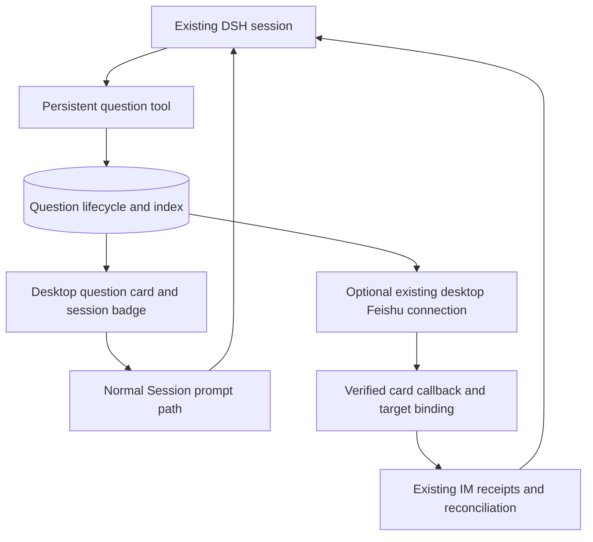

# Octopus Human-Led Orchestration Design

**Status:** Revised design proposal. Delivery order: Stage A native teamwork, Stage B session-bound persistent decisions, then Stage C task runtime only when justified. Implementation and acceptance remain pending. The [implementation roadmap](2026-11-03-octopus-implementation-roadmap.md) links the separate A, B0/B1, and B2 plans; Stage C has no implementation plan.

**Scope:** A local, customizable orchestration layer built on DeepSeek Harness (DSH). This English working document specifies the proposed behavior; it does not claim that the behavior is already shipped.

## Summary

Octopus remains a human-led local agent workbench. First deliver native teamwork guidance using existing Team tools. Then attach persistent questions to existing sessions: users can answer from the desktop or, while the host is online, Feishu. An answer starts a new turn in the same session without restoring an old wait handle. Defer outer Tasks, Attempts, dependency scheduling, and event automation until operational needs justify them. Skill guidance does not establish runtime enforcement.

## Contents

- [Product decisions](#product-decisions)
- [Existing capabilities and design choices](#existing-capabilities-and-design-choices)
- [Combined roadmap and native teamwork](#combined-roadmap-and-native-teamwork)
- [Stage B architecture and scope](#stage-b-architecture-and-scope)
- [Decision lifecycle and expiry](#decision-lifecycle-and-expiry)
- [Input sources and authority](#input-sources-and-authority)
- [Waiting and execution settlement](#waiting-and-execution-settlement)
- [Persistence and recovery](#persistence-and-recovery)
- [Stage C task runtime](#stage-c-task-runtime)
- [Permissions and deployment](#permissions-and-deployment)
- [Delivery stages and acceptance](#delivery-stages-and-acceptance)
- [Open decisions before implementation](#open-decisions-before-implementation)

## Product decisions

1. Human-led operation is the default. A manual task does not require the event-trigger module, an IM account, or a second model provider.
2. Event-driven operation is an optional plugin composition, disabled by default. A user explicitly enables each rule and its permitted actions.
3. Stage B uses existing sessions and their execution queue, not a new task scheduler. If Stage C is justified, manual and event tasks share its admission service and scheduler while retaining distinct source identities and authorization.
4. IM is an interaction channel, independent of the trigger source. Both manually initiated and event-triggered tasks can request human decisions through IM or the desktop.
5. A decision can outlive its requesting turn and a host restart. An answer starts a new turn in Stage B, or a new attempt in Stage C; it never revives an old Promise or approval handle. Persistence does not guarantee IM callbacks while the host is offline.
6. Reuse DSH execution and permission mechanisms. Do not replace the agent loop, rebuild tool scheduling, or create a competing Team task board.
7. Keep infrastructure deterministic. An LLM may propose work or interpret business content; it does not decide task ownership, answer validity, concurrency limits, or permission grants.

The product value is local ownership, inspectable code, enterprise plugin development, and control over data and execution policy. Feature parity with general assistants is not the organizing principle. Local execution and an internal network reduce some exposure but do not establish plugin trust or prevent data disclosure through configured model providers and IM channels.

## Existing capabilities and design choices

The following references identify reusable DSH owners and their limitations. They are a source assessment, not installed-product or live-platform acceptance.

| Existing owner | Reuse | Limitation relevant to this design |
| --- | --- | --- |
| [Goal](../../packages/goal/goal/README.md) and [round driver](../../packages/goal/goal-round-driver/src/index.ts) | Same-session objectives and bounded automatic continuation | Goal activation is process-local; restoring a session does not grant permission to resume it |
| [Schedule runtime](../../packages/schedule/schedule/src/runtime.ts) | Host cold-session restoration and delivery pattern | Session append and schedule-row update are separate; delivery can repeat after a crash and is not business completion |
| [Webhook](../../packages/webhook/webhook/README.md) | Authenticated ingress adapters and trusted routing | Current ingress is not a complete durable task queue with result recovery |
| [Agent Teams](../../packages/experimental/agent-team/src/types.ts) | Native delegation and team-owned task coordination | Team tasks and standing-team rounds must retain their existing semantics |
| [Feishu IM runtime](../../packages/experimental/im-feishu/README.md) | Identity binding, delivery records, optional questions and approvals | Existing interaction brokers depend on active waits; persisted records alone do not resume an exited execution |
| [Desktop IM](../../packages/experimental/desktop-im/README.md) and [DingTalk IM](../../packages/experimental/im-dingtalk/README.md) | Desktop account configuration, private-message ingress and replies | Desktop composition does not install an IM approval/card answerer; DingTalk approval cards are not implemented |
| [Storage domain](../../packages/storage/storage-domain/README.md) and [SQLite backend](../../packages/storage/storage-sqlite/README.md) | Atomic single-record writes and serialized domain updates | No cross-record transaction or automatic domain-version migration |

The inspected agent-autoloop source separates events, runs, cards, answers, and subsequent runs. Its answer handler emits `card.answered` and enqueues work. The inspected Orca source separates Tasks from Dispatch records and applies readiness and executor concurrency checks. These are useful patterns rather than interchangeable implementations. External comparison paths are `agent-autoloop/kernel/decide.ts` and `orca/src/main/runtime/orchestration/{coordinator,db}.ts`; no runtime dependency on either project is proposed.

Four architectural options were considered:

| Option | Benefit | Cost or limitation |
| --- | --- | --- |
| Session-bound persistent decisions; recommended next | Answers the immediate leave-and-return use case using existing sessions | Requires durable answer delivery, source policy, and context revalidation; does not orchestrate independent tasks |
| Human-led workbench with optional event triggers; deferred | Supports unattended work through shared task management and recovery | Requires Tasks, Attempts, execution ownership, and a scheduler |
| Event-first hub with manual work treated as another event | Natural fit for unattended business processes | Makes background operation the organizing product experience |
| Extend only Goal and its continuation driver | Smallest initial addition | Leaves cross-executor ownership and decisions spanning exited attempts under-specified |

The next runtime addition is session-bound decisions. The outer task runtime remains a separate later stage. The earlier [native team orchestration plan](2026-11-02-native-team-orchestration.md) contributes Stage A below. This document coordinates the combined roadmap; the earlier draft is a requirements reference and must not be executed unchanged.

## Combined roadmap and native teamwork

The plans solve different problems. The earlier plan teaches a Lead how to use existing teammates, task dependencies, messages, model selection, and evidence. The later runtime makes attempt ownership, durable human decisions, and recovery enforceable in code. Keep those deliverables separate while sharing terminology, task specifications, and acceptance artifacts.

The [Cursor review](../../.plans/native-team-orchestration/cursor-review-2026-11-03.md) finds the earlier draft not ready to implement. Its findings remain open until the affected plan and implementation acceptance are reviewed. This consolidation incorporates the relevant design constraints; it is not a claim that all seven findings are closed. Historical baseline test results are not fresh verification of this combined design.

### First delivery: native teamwork skill

Deliver a default-discoverable `team-orchestration` skill through the existing bundled-skills pipeline. It requires neither a task store nor IM or event configuration. Its supported workflow is: define the requested outcome and evidence, select authorized teammates, assign non-conflicting work, coordinate dependencies, inspect artifacts, and account for incomplete work. Reuse the existing collaboration panel. Keep discovery metadata narrow: explicitly requested DSH teamwork and supervision only. The catalog does not filter skills by available tools. Narrow metadata, explicit missing-tool guidance, and recorded traces must discourage recruitment in ordinary and data-assistant sessions; this is not a discovery-time enforcement mechanism.

Retain these requirements from the earlier plan:

1. Give each assignment a concrete deliverable, relevant materials, constraints, dependencies, one editing owner per shared file, requested model selection, and acceptance evidence. These are assignment instructions; advisory write scopes are not filesystem locks.
2. Distinguish ad-hoc teams from a standing squad before dispatch. In a standing-squad session, use the existing seat names and task board without spawning replacement or additional members. Seat model changes belong to the institution catalog. Round scheduling remains its existing Host operation, not an invented model tool.
3. Preserve the supported model-selection rules. Fresh ad-hoc spawns accept provider/model together or neither, subject to the session route policy. Fork spawns do not accept route overrides. State requested and effective selections separately, relay tool errors, and do not claim reasoning effort was preserved when a route change omitted it. Follow the existing Team language policy rather than adding a conflicting skill rule.
4. Route teammate questions to the Lead through native messages. A Lead action proposal is an execution-approval request, not a generic question channel. Skill text cannot create a read-only worker or grant permissions; review-only assignments request no edits and retain the existing session permission checks.
5. Verify task state, artifact evidence, and child execution separately. An interrupt result is not confirmed termination or ownership release. A roster `completed` outcome is not task acceptance. Do not reassign overlapping edits until execution has demonstrably stopped; preserve unresolved status when that cannot be established.
6. Do not automatically replace a worker after timeout or resend a message merely because it is queued. Generic model-facing sends do not expose the keyed round/slot/attempt deduplication fields. Failed provisioning consumes the teammate name; a same-name respawn is not a recovery method.
7. Require worker reports to identify artifacts, checks, limitations, and whether edits occurred. The Lead accounts for every requested task and verifies the claimed result. This is a workflow obligation until a runtime validator owns the relevant acceptance check.

### Review findings carried into delivery

| Earlier review | Combined design requirement | Completion evidence |
| --- | --- | --- |
| R1: lifecycle probes and ownership | Use owner-defined expected results; do not repair a documented limitation by expanding scope | Stale revisions and blocked claims reject with current errors; interrupt retains ownership; stopped workers can leave tasks incomplete; cold-target receipt uses durable delivery and child evidence |
| R2: standing squads and models | Separate standing-seat dispatch from fresh ad-hoc spawning and preserve actual route policy | A standing-squad trace creates no extra member; route override errors and effective selections are visible; owned seats do not trigger replacement work |
| R3: review-only authority | Describe assignment intent separately from enforced tool access | Review trace requests no edits; unchanged permission path remains observable; no claim of a task-created read-only mode |
| R4: prompt guidance versus enforcement | Separate runtime assertions from cooperative model traces | Replay demonstrates the selected workflow only; stronger spawning, retry, and acceptance guarantees require owning code and adversarial tests |
| R5: skill distribution | Include a private dependency-free `package.json`, guide, and explicitly loaded reference paths | Reuse existing seed rejection of missing guide/manifest; add reference-file checks to seed qualification and the actual DMG verifier; verify installed discovery, refresh, and project precedence |
| R6: bilingual meanings | Correct the earlier pair if it remains an implementation document | Review verifies attempt authority, settlement, and model errors before pairing hashes are re-recorded; this English consolidation does not repair that pair |
| R7: draft execution banner | Keep review drafts distinct from implementation instructions | Before executing the earlier plan, remove its contradictory banner and revise its tasks against the findings |

The skill files proposed by the earlier plan remain `.agents/skills/team-orchestration/SKILL.md`, `references/task-spec.md`, and `references/recovery.md`, with the added package manifest required by the seed owner. The guide must direct explicit reads of its reference files; skill loading alone does not return their content. Add the manifest pin and narrowly extend the actual macOS bundle verifier during implementation. Preserve existing refresh and discovery precedence rather than changing them to accommodate the skill.

Use the shipped headless profile with an explicit Team composition for recorded-session coverage; ordinary headless composition alone does not establish Team tool availability. Separate stale-revision and other deterministic runtime assertions from scripted model compliance. Verify desktop installation separately through the produced installer. No product, skill, packaging, or test code is changed by this consolidation.

### Transition to persistent decisions

The native workflow can ship independently after its own review and acceptance. It supplies task-writing conventions, supervision guidance, representative scenarios, and packaging checks for later stages. Stage B adds a persistent question service without requiring an outer task board, automatic retries, or a new model.

Retain the skill as guidance in every stage. Stage B questions belong to sessions; Team assignments remain on the native board. If Stage C is later justified, its outer task references the outcome, session, and Team rather than mirroring teammate assignments. Durable outer completion requires its own evidence, including settlement of owned delegated work.

Existing Team availability remains sufficient for the skill-only stage. Later runtime claims require explicit integration with their executing owners, including cancellation settlement and result attribution; they cannot be inherited from a successful skill demonstration.

## Stage B architecture and scope

Stage B1 is a thin structured-conversation feature: a question card, a pending badge in the existing session navigation, expiry, and desktop answers through the normal Session prompt path. Sessions already preserve ordinary chat across restart; the additional value is an identifiable pending question with explicit lifecycle and answer controls. B1 adds no background answer dispatcher, outer Task, Attempt, dependency scheduler, or new task panel.

Stage B2 adds Feishu cards using desktop-im's existing connection and im-feishu's receipts and Session reconciliation. Generic card/target ports stay in im-feishu without a dependency on session-decisions; decision-specific adapters live in session-decisions/feishu. The session-decisions service is the sole writer of persistent-question publication state in the decision aggregate. The current IM provider targets its own conversation session. Answering another session requires a validated decision-target adapter; existing free-text mapping must not be widened to trust arbitrary session IDs. One desktop-owned Feishu connection handles ordinary messages and card callbacks.

All decision answers use the next-turn queue: desktop uses explicit `mode: queue`, while the IM receipt path uses `followup()`. Validate revision, expiry and choice before admission. Once accepted, always deliver the answer as human input; later context changes supersede question status but never filter the answer out of a model step. The Session log owns admitted answers. The single decision record owns question data, revisions, context, expiry, lifecycle and pointers to normal prompt request IDs or IM receipts. It does not store a second authoritative answer body. Neither its indexing state nor a transport acknowledgment establishes business completion. Expired/superseded/cancelled card status is Remote-backed storage state; a Session export or replay without that service does not reproduce those live labels. Client card tests must include the Remote state owner.

Use Cordis plugins with complete service/provider/consumer roles and effect-owned registrations. The [B0/B1 plan](2026-11-03-octopus-stage-b0-b1-persistent-questions-plan.md) names concrete owners and checks. Implement UI through existing header/sidebar slots and pure tool presenters; official desktop, desktop-app, and companion product logic remain unchanged. Missing extension points must be identified before promising overlay enforcement.

The proposed question tool appears only in explicitly composed root sessions. It supports information questions and choices, not persistent command-approval handles. Register it as exclusive; once the question is saved, a scoped monotonic guard denies leftover tool calls from the producing step. The guard denies all tools only until matching producing-step/turn settlement or context disposal; later human and non-human steps have tools available. Positions are observed through session/event, never deprecated synchronous log reads; no claim reset is needed. Awaited admission checks use `tools/pre-execute`; turn conclusion uses the existing conclusion mechanism. The feature-owned persistent-questions preset restates standard plus the scoped consumer and pins native presentation, keeping default standard unchanged. Shipped PTC omits both tools; a later user edit retaining the consumer under PTC accepts SDK advertising plus nested-question refusal rather than silently overriding the edit. Nested question creation in explicitly enabled both-mode trees is refused because a parent program can continue non-tool code after a nested tool returns. Ordinary chat remains the fallback.

## Decision lifecycle and expiry

Each decision is one aggregate with a branded ID, session ID, record revision, requesting turn reference, question, choices, authorized responder policy, context revision, expiry, lifecycle state, optional answer request-ID or receipt pointer, notification references, suspension reason, and format revision. The admitted answer lives in the Session log; the aggregate retains only the indexing and conflict-checking data needed to locate it. Permit one unresolved decision per session initially, enforced by the single Host writer's session-keyed admission queue and rebuilt index, rather than a second durable index requiring a transaction.

The decision states are `open`, `answered`, `expired`, `cancelled`, and `superseded`. Answer admission is separately indexed as `none`, `submitting`, `admitted`, `needs_reconciliation`, `withdrawn`, or `dismissed` (withdrawn records queue absence, not a cause or user cancellation; entered evidence wins, and disposal observed before its withdrawal write commits can classify it as needs_reconciliation; a later close does not reopen a settled tombstone); these labels are not a new desktop delivery queue. User pause prevents answer admission until explicit resume. B2 maps existing IM receipt outcomes into that index instead of implementing another reconciler. B1 reserves at most one Remote prompt submission per decision; every non-none answer index prevents resubmission, including a new card request ID. Ordinary human input remains available. The authenticated dismissUnresolvedAnswer action closes unresolved tracking as cancelled/dismissed without replay, retraction or cancellation of queued Agent input; the closed tombstone becomes retention-eligible. Cold pending inspection waits for a real restored Agent and the public inbox projection; it never wakes an Agent solely to reconcile. Agent/service shutdown retains unsettled unentered evidence as needs_reconciliation, leaving settled withdrawn/dismissed tombstones closed; only crash-style restart can preserve a queued inbox entry.

| Event | Decision and delivery result |
| --- | --- |
| Valid question request | Create `open`; notification becomes pending |
| Valid answer before expiry | Reserve the answer revision and normal request ID or IM receipt reference, submit through the existing path, then mark `answered` from durable Session evidence |
| Same answer replay | Resolve the existing request/receipt identity and return its known outcome; create no second answer |
| Conflicting or unauthorized answer | Reject; preserve the accepted answer and delivery state |
| Expiry while `open` | Set `expired`; reject further answers; require a new question revision to ask again |
| User declines an offered choice | Record a negative answer; deliver that choice, without executing the declined proposal or inferring an alternative |
| User pauses | Retain question or admitted answer; prevent new answer admission until explicit resume |
| Explicit resume | Revalidate identity, context, expiry where applicable, and delivery evidence before continuing |
| User cancels question or stops the workflow | Cancel unanswered/pre-admission work and invalidate future callbacks; do not retract already accepted human input through question lifecycle handling |
| New conversation input or edited proposal | Supersede stale question/indexing state; preserve accepted human input, including an answer that became stale; the exact correlated answer does not supersede itself |
| Restart after answer admission | Rebuild answer indexing from normal request/receipt evidence; desktop does not automatically resubmit; B2 preserves existing unknown-receipt rules |

The service owns expiry timers and accepts an injected clock. Persist absolute UTC expiry; use bounded monotonic delays for scheduling and recheck the wall clock at answer commit. On startup and on every read/answer, apply overdue expiry even if no timer ran. Test rollback, forward jumps, restart, and answer-versus-expiry ordering. An accepted answer does not expire retroactively, but its context and any proposed action must still be revalidated before use.

Example: a user starts a supplier comparison and the agent asks for a budget choice. While the desktop Host remains online, the user answers in Feishu; the answer starts a new turn in the same session. If the desktop is closed, the decision remains available after restart and can be answered there. IM answers sent while offline have no delivery guarantee until real-platform qualification establishes one. Sending the comparison externally still follows the session's tool approval policy. This is an acceptance scenario, not an existing customer case.

## Input sources and authority

Every producer must supply an explicit source; omitting it can default to human authority. Preserve the original trigger identity in business records even when a later human answer is legitimately logged as human input. The [Goal authority owner](../../packages/goal/tool-goal/src/authority.ts) recognizes a root turn containing `kind: user` as direct human input; source selection therefore changes capability authority, not merely display labels.

| Input | Source and identity rule | Authority and delivery rule |
| --- | --- | --- |
| Manual first input | Existing authenticated desktop or IM human path, explicitly `kind: user` | Existing human-turn permissions apply; no extra tool privilege is created |
| Event first input, Stage C only | Explicit non-human producer source, never an omitted source or `user` | Rule-scoped automation policy; no direct-human Goal authority |
| Authenticated decision answer | Existing human source with fresh request identity allocated once and saved with the answer | Existing human-turn authority applies, including current Goal tool checks; this is not a narrowly scoped source capability |
| Recovery of an answer submission | Inspect the same normal request ID or existing IM receipt; B1 has no background resend and B2 retains current unknown-state rules | No invented human action, changed answer, or new authority grant |
| Automatic execution retry, Stage C only | Explicit non-human retry source linked to original trigger and prior attempt | Does not inherit human authority merely because the original task was manual |
| Notification, timer expiry or delivery bookkeeping | No model message unless separately required; any emitted automatic input uses an explicit non-human source | Cannot approve a decision or resume Goal |

Stage B intentionally treats a verified human answer as human input, matching current Feishu semantics. Consequently, current human-only features remain available in that turn; the design does not claim that a yes/no answer creates a restricted Goal privilege. The question UI and prompt must distinguish supplying information from approving an action. Subsequent tool operations retain their own permission checks. The decision service does not resume Goal. However, a full-human answer turn may let the model resume an active-but-disarmed Goal; core separately rejects model resume of a truly paused Goal. Preserve those checks rather than presenting service behavior as an enforced manual-only restriction. Because two human-source consumers scan every text block of an admitted user message for user-only gestures — skill activation (`packages/skill/tool-skill`) and session-reference expansion (`packages/context/session-reference`) — a choice answer never echoes model-authored labels: the Host composes `Answer to question <uuid>: option <n>` from a UUID decision ID and a numeric ordinal, and the model retrieves question context from its logged `tool/call` plus a specified read-only question tool. The B0 evidence in the stage-B0 plan fixes the exact rule.

The complete implementation roadmap retains this full-human-authority choice. B0 inventories all human-source consumers to verify its consequences; it does not silently narrow `user`. If that audit exposes an unacceptable capability implication, revise the policy and affected consumers before coding that slice.

Reuse existing types where semantics match. New source variants, changed persisted meanings, or new Session events require [persistence-type review](../cookbook/reviewing-persistence-type-changes.md), affected SDK projections, and the [Session-format policy](../session-format-status.md). A source-policy table alone does not require changing a persisted union; the implementation must identify the actual type changes.

## Waiting and execution settlement

Stage B does not assume an exclusively owned session. Waiting describes one decision, not a guarantee that all future conversation activity has stopped. Any incoming material that changes the context invalidates the pending question or continuation before the dependent action can proceed. Existing live question and approval tools retain their current behavior.

For the initial question tool, reject creation while the requester has running owned background jobs or active delegated work whose settlement cannot be established. The typed error tells the model to ask in ordinary chat instead, or retry after owned work settles; it must not cancel or replace teammates. Test that path in a Team-composed recorded flow. Disarm Goal activation before publishing a successful wait without changing its phase to paused. Use state-derived wording such as “自动续跑已停止，回答后可能继续”: the service does not resume, but the answer-turn model retains existing human authority. Preserve the user-only rule for resuming a truly paused Goal. This bounds the first version without requiring durable suspension of arbitrary jobs or teammate graphs. An unresolved settlement leaves the current workflow unresolved rather than announcing a safe wait.

| Input while a decision is pending | Stage B handling | Later managed-task handling in Stage C |
| --- | --- | --- |
| Desktop prompt in the asking session | Serialize against answer intake; supersede stale question or pending admission, then accept ordinary human input | Submit through task admission as a revision or separately chosen conversation; never silently join an owned attempt |
| Ordinary Feishu private text | Goes to the existing IM session/workspace, not to this question; card copy says buttons answer and typed text starts a separate conversation | Preserve explicit channel routing; do not infer a task target from text |
| Answer callback | Validate exact decision/context before admission; submit once as a queued next-turn answer; never filter accepted human input | Same checks plus exact task revision and attempt ownership |
| Schedule reminder | Keep its non-human source; context-changing input supersedes the pending decision | Hold before execution admission until task policy permits it; ordinary Schedule delivery must not bypass this |
| Team message to Lead | Record as Team input; invalidate stale decision context; do not mistake it for the answer | Hold as correlated input; do not admit a competing attempt |
| Background-job completion | Preserve notice and non-human identity; invalidate stale context; no implicit answer | Record settlement and hold model wake until managed admission permits it |
| Goal continuation | Goal remains disarmed for the pending question; a fresh explicit human operation uses existing authority rules | Runtime cannot silently rearm it after restore or retry |
| Expiry or notification retry | Update aggregate only; no model wake | Same |

This table describes question status, not a reason to remove admitted Session input. Use synchronous `agent/inbox/inserted` to mark context dirty and queue durable supersession outside the notification callback. Observe claims and entered messages to resolve queued-answer races; the tool guard resets at producing-step settlement before the next claim. Do not rewrite or filter accepted answers in `agent/pre-step`; input omitted from its returned list could disappear after the send path acknowledged acceptance. A stale answer that has already been admitted remains ordinary human text, and the model must revalidate before acting. Test native and PTC tool guard paths and normal queued/steered human interaction separately.

For Stage C, define quiescence over the exact execution owner and its delegated descendants: no open turn or active tool execution, no running owned jobs, no active owned teammate/standing-round work, no admitted continuation still owed to that attempt, and no armed Goal driver. Hold admission while checking and settling ownership; an idle sample alone cannot establish this condition. Unknown ownership prevents conflicting replacement work. Do not stop unrelated sessions merely to satisfy a workspace-wide idle test.

The [turn conclusion mechanism](../../packages/core/agent/src/runtime-types.ts) does not discard already-submitted next-step input or racing steering. A concluding tool therefore requests closure; it does not prove quiescence. Queue an answer behind the requesting turn, validate before admission, and preserve it after acceptance even if context changes. Stage C additionally requires enforcement against post-result tool activity and racing external producers.

## Persistence and recovery

Use existing storage-domain with one record per question and atomic read-modify-write. Notification state and answer request/receipt references remain in that record. Rebuild session indexes from records under one Host writer; no cross-record, cross-process, or SQLite-to-Session transaction is claimed. Storage versions fail on mismatch and do not migrate. The feature owns supported format decoders, backups, validated record conversion, and any offline domain-version conversion before open.

B1 sends desktop answers through the existing public Session prompt path, including its request-ID duplicate recognition and human source construction. The UI/feature validates the question and reserves indexing state before admission. Session evidence is authoritative for the admitted answer; update the index after durability is established. If a response is lost, inspect the same request identity. Do not add a timer that resends desktop prompts. Ambiguous evidence remains `needs_reconciliation` and requires explicit user action.

B2 uses the existing im-feishu receipt machinery, bounded Session readers, and reconciliation policy. Recovered receipts lacking a matching prompt stay unknown and are not replayed. A callback-bound asking-session provider must prove the target from the stored decision and current authorized binding. Do not weaken the ordinary IM conversation-to-session checks or reuse live question-broker handles. Receipt admission, decision indexing, publication and Session writes remain separately durable operations with failure-cut tests.

Notification publication may be pending, in-flight, sent, failed or unknown. Use existing qualified publication/transport ownership and provider idempotency where available. Unknown publication success never creates another decision or grants an unverified callback authority. Desktop answering remains available during channel failure.

| Interruption | Recovery |
| --- | --- |
| Orderly shutdown with an open question | Drain accepted writes and retain the question; reconstruct it at startup without starting a model turn |
| User pause or cancellation | Preserve that choice across restart; do not resume it automatically |
| Lost desktop answer acknowledgment | Inspect normal Session request evidence; repair indexing when proven; do not automatically resend |
| Recovered IM receipt with no matching prompt | Keep existing unknown outcome; no automatic replay |
| Shutdown during a model turn | Preserve actual cancellation/finish facts and shutdown reason separately; do not replay business actions automatically |
| External effect unresolved after clean exit or crash | Keep `needs_reconciliation`; a clean exit does not prove retry is safe |

Expiry belongs to the decision service, with an injected UTC clock and bounded monotonic timer delays. Apply expiry at startup and on read/answer even if no timer ran. Configuration defaults and retention tests are specified in the B0/B1 plan. Do not prune live callback or answer-deduplication evidence. Deleting a question does not imply deleting Session history, IM messages or external artifacts.

## Stage C task runtime

Stage C has no implementation plan or scheduled work. Reopen it only for a concrete workload requiring independently queued execution, unattended automation, cross-session dependencies or multiple executors. A decision-expiry timer alone does not justify it.

A future design starts with one outer task per managed session, shown in its existing header/sidebar entry, and one scheduler shared by manual and optional event admissions. Native Team tasks remain the assignment board. It must freshly specify attempt ownership, quiescence/admission enforcement, effect uncertainty, shutdown versus cancellation, budgets, workspace exclusion, source semantics and storage limits. Single-record atomicity is not a cross-task transaction. Do not preserve speculative implementation schemas as commitments.

An event module would own its timers and occurrence IDs rather than changing Schedule's fixed Session-delivery destination. Reusing actual Schedule occurrences would require stable task/occurrence deduplication and its documented repeated-delivery handling. Any upstream-owned package change requires intake registration. This paragraph records constraints for a future review, not implementation tasks.

## Permissions and deployment

Use a single-user local Host first. Keep network listeners loopback by default; external ingress requires an authenticated deployment. Store credentials in existing facilities. Publish minimal question content, not repository files, secrets, or full model context. Internal networking does not replace plugin review, pinned dependencies, constrained credentials, filesystem permissions, or model/IM egress controls. Optional marketplace access and automatic third-party installation remain disabled by default.

Feishu is the first optional answer channel; desktop answering is the baseline. DingTalk follows only after a qualified answer implementation. Real long-connection and callback behavior must be tested with an authorized application, including disconnect, reconnect, offline clicks, private replies, duplicates, expiry, and actor changes. Until then, product wording is: “Answer in Feishu while the desktop is online; otherwise reopen the desktop to answer.” Persistence is not an always-on service.

No learned model is required. The separate Astra weight-editing experiment does not own authorization, decision validation, or scheduler transitions. Stage C unattended hosting must use supported `dsh` profiles and its own qualification. Desktop distribution uses pinned overlays, dependency closure, existing bundle checks, and fresh installed-flow validation. Client copy belongs in typed locale dictionaries, with Chinese desktop text.

## Delivery stages and acceptance

| Stage | Deliverable | Required evidence |
| --- | --- | --- |
| A. Native teamwork | Correct the earlier draft and review findings; skill, references, seed and installer qualification | Native tools and effective models match guidance; ordinary requests and missing-tool compositions do not recruit in tested traces; runtime assertions remain separate from scripted compliance |
| B0. Implementation proof | Authority-consumer audit, inbox insertion/claim and tool/PTC mapping, aggregate/index ownership, normal prompt path and Host-test composition | Required hooks and current semantics are verified before B1 code; full-human authority and thin B1 are the roadmap defaults |
| B1. Thin desktop questions | Structured card, session badge, expiry, normal desktop answers and restart indexing | Session-owned answer evidence, existing request-ID handling, no background answer-delivery engine, explicit Goal continuation and safe Team/PTC fallback |
| B2. Optional Feishu | Cards on the existing desktop connection; answers through existing receipts to the validated asking session | Button/free-text separation, source/target checks, unknown-receipt preservation, authorized platform tests and installed desktop fallback |
| C. Deferred | No implementation plan | Concrete need and a fresh design review are required before planning work |

Stage A is independently deliverable. B0 must complete before B1. B1 is useful without IM; B2 adds the channel. Stage C remains deferred until its justification and design review are complete. Installer qualification accompanies each shipped composition rather than being postponed to the end of the roadmap.

Use the real Host session controller and Session persistence for B1 and B2 tests. Stage A's headless Team snapshot composition does not cover those services. Extend the recorded-session harness with a Host-capable composition or a qualified equivalent in the same implementation change; a plain headless replay is insufficient. Add localized client interaction coverage, tool presentation checks, and SDK expectations when their owned events change.

Required recovery fixtures include answer versus expiry/cancel/pause, desktop versus IM answers, new input versus pending answer, lost publication acknowledgment, crashes on both sides of Session flush, clean shutdown with an unanswered question, user cancellation across restart, and an external effect unresolved despite clean shutdown. Inject clocks and executor barriers; do not use sleeps as race evidence. Verify missing skill references through existing seed/DMG owners. Real-platform and packaged-app results remain separate from synthetic tests.

## Open decisions before implementation

The product direction is fixed; the following implementation questions belong to B0/B2 or a future runtime design review. They are not permission to fill gaps with silent defaults.

| Question | Proposed default or constraint | Owner and required resolution |
| --- | --- | --- |
| Can question supersession and guard release follow all relevant inputs? | Insertion marks stale status; producing-step settlement releases the guard before the next claim; accepted human input is never filtered | B0 maps insertion/claim evidence and producing-step settlement with next-turn queue behavior; B1 tests late staleness, steering, and transcript preservation |
| Which consumers are affected by authenticated human answers? | Full existing human-turn authority is retained, matching existing authenticated human messages; no scoped `user` claim | B0 inventories and tests affected consumers; an unacceptable implication requires explicit policy revision rather than a silent type change |
| Which existing evidence proves an answer was admitted? | B1 uses normal prompt request-ID evidence; B2 uses existing IM receipts and Session reconciliation | B0 verifies public reader access and flush ordering; B2 verifies target-bound reuse; ambiguous evidence is not automatically replayed |
| Which aggregate formats are supported and how are they upgraded? | Explicit decoder and runtime-owned, backed-up record conversion; backend does not migrate | B0 specifies conversion, validation failure, rollback and domain-version handling |
| How are expiry and retention bounded safely? | Defaults are owned by the B0/B1 plan; injected UTC clock plus monotonic timer delays | B0 verifies startup expiry, safe record limits and retention of unresolved evidence |
| What happens to Feishu callbacks while offline? | No delivery guarantee; online-only IM wording and desktop fallback | B2 verifies the real app before any stronger claim |
| Does the post-question guard cover PTC? | Feature preset pins native even under DSH_TOOLS_MODE=ptc; shipped PTC omits the consumer; user-edited PTC advertise-and-refuse is accepted; same-step root run_code is denied while armed | B0 pins preset ownership; B1 tests process-default override, shipped-Preset absence, user-edit precedence and PTC refusal |
| Can the existing IM owner safely target the asking session? | One connection; explicitly validated decision target, separate from free-text mapping | B2 adapter review and failure tests precede platform qualification; no generic session-ID bypass |

The original Cursor review remains an independent artifact. This revision addresses design requirements without declaring its implementation findings closed. The supplied Opus review additionally motivates Stage B and the explicit storage, authority, lifecycle, shutdown, and Host-test obligations above. No real Feishu, installer, or runtime acceptance is claimed by editing this document.

## Dev Note

This English working design is explicitly listed in the translation-pairing exclusion manifest. Implementation must update owning package references and standing decision records as behavior becomes real. This revision changes the design only.
